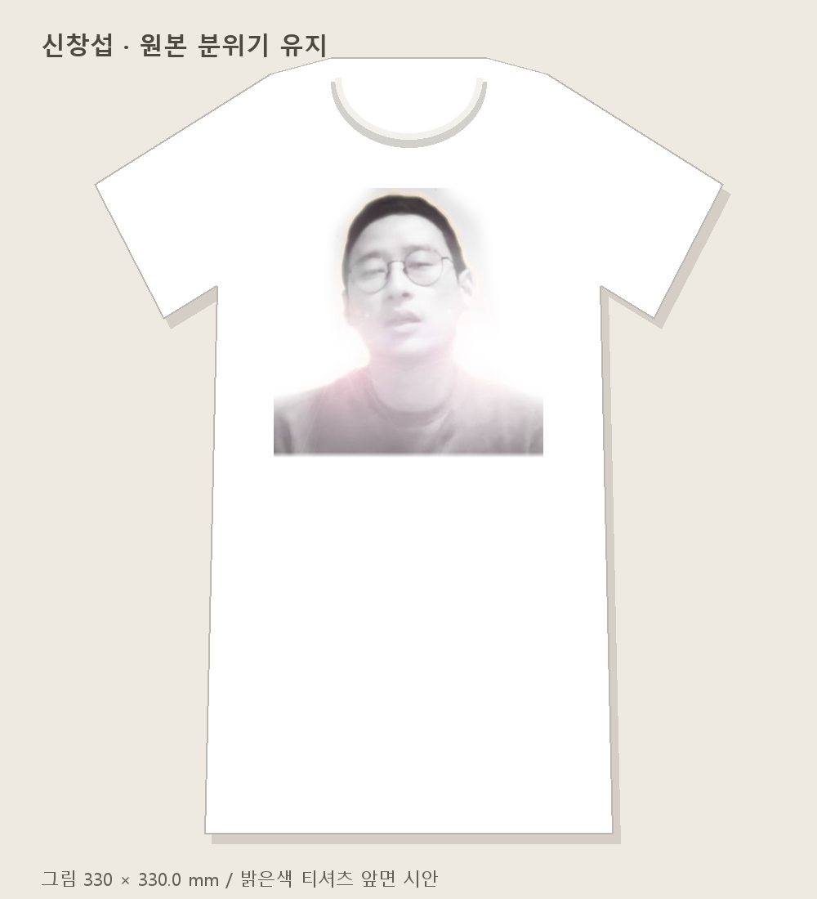
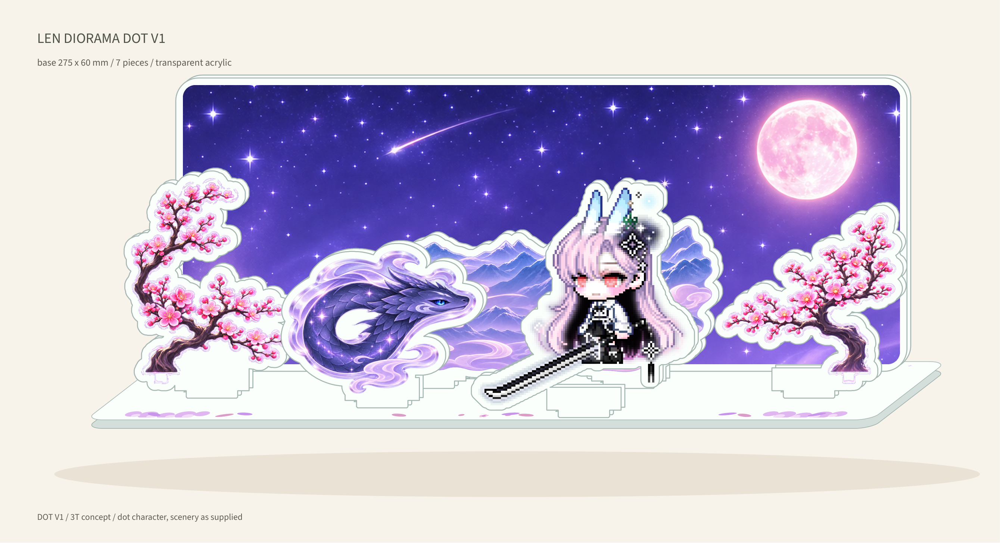

## 현재 출력: [A3 최종본 · 추가 이미지 / 줄줄이 키링 / 어센트 / Len](a3_release)

> **2026-11-20 칼선 곡선화 수정본입니다. 기존 다운로드를 교체하세요.** [전수 검사·변경 내용](https://github.com/ark1st/dpbr_goods/tree/output_len/output/cut_quality)

# 내일 출력할 최종 파일 · 2026-11-20

1. [가람·단팽이·메인 로고 합본 V3 + 카라비너 샘플 ·11조각](combined_diorama_v3/README.md)
2. [엑스트라 시트 (김윤양지수) ·yun 스탠드 추가38조각](extra_sheet/README.md)
3. [아잉 얼굴 티셔츠 ·시안·DTG 인쇄 파일](tshirt_fronts/aing/README.md)
4. [신창섭 티셔츠 ·시안·DTG 인쇄 파일](tshirt_fronts/changseop/README.md)
5. [마스코트·로고 키링 V4 ·16조각](production_v4/README.md)
6. [연결형 튀잉4종 · 각각 별도 판](linked_tuiing_v1/README.md)
7. [렌 아크릴 디오라마 DOT V1 · 캐릭터만 도트 아바타판 ·7조각](len_diorama_dot_v1/README.md)

## 단바 합본

[전체 ZIP](Danpungbaram_Combined_Diorama_V3_TRIALS_11pcs.zip) ·
[3T AI](combined_diorama_v3/3T/02_COMBINED_MASTER.ai) ·
[5T AI](combined_diorama_v3/5T/02_COMBINED_MASTER.ai)

3T/5T 중 실제 판에 맞는 한 종류만 선택합니다.
310×205mm에서300×175mm로 대지를17.4% 줄였습니다. 그림 크기와11조각 수량은 그대로입니다.
카라비너 본체마다 레이저 장착 구멍2개가 있습니다. 지름·간격이 다른4종과 같은 판의 시험편9조합으로 조립을 확인합니다.
[카라비너 상세 시안·조건](carabiner_trials_v1/README.md)

## 엑스트라 시트

[3T ZIP](Extra_Sheet_38pcs_3T.zip) · [5T ZIP](Extra_Sheet_38pcs_5T.zip) ·
[AI](extra_sheet/05_MASTER.ai) · [인쇄 PNG](extra_sheet/02_PRINT_300ppi.png) · [재단 PDF](extra_sheet/03_CUT_ONLY.pdf)

기존33개의 그림 크기와 외부30개의 칼선은 유지했습니다.
추가한yun의 받침3개는1인용2개·2인용1개입니다. [3T](extra_sheet/3T) / [5T](extra_sheet/5T) 중 선택하세요.
홈20.2×3.2/5.2mm, 돌기2.6/4.6mm로 조정했으며 최상단 파일은3T 사본입니다.

## 티셔츠

| 아잉 | 신창섭 |
|---|---|
|  |  |
| [인쇄 PNG](tshirt_fronts/aing/01_DTG_14x16in_300ppi.png) | [인쇄 PNG](tshirt_fronts/changseop/01_DTG_14x16in_300ppi.png) |

[티셔츠 ZIP](Tshirt_Fronts_Aing_Changseop_14x16in.zip)
안내문 규격14×16인치,300ppi 투명 PNG. 흰색·밝은색 옷용.
신창섭은 생성형 보정 없이 원본 분위기를 유지해 확대했습니다.

## 렌 디오라마 DOT V1 (도트 캐릭터판)

[전체 ZIP](Danpungbaram_Len_Diorama_DOT_V1_MAIN_7pcs_3T_5T.zip) ·
[인쇄 PNG 3T](len_diorama_dot_v1/3T/01_PRINT_300ppi.png) · [5T](len_diorama_dot_v1/5T/01_PRINT_300ppi.png) ·
[마스터 AI 3T](len_diorama_dot_v1/3T/02_MASTER.ai) · [5T](len_diorama_dot_v1/5T/02_MASTER.ai)

NEW V1과 같은 구성(베이스 275×60mm·홈 8·깊이 행 5·7조각)에서 **캐릭터 판만 본인 캐릭터의 인게임 도트 아바타 렌더(official_avatar_180)로 교체**했습니다.
도트 계단이 인쇄에서 그대로 보이도록 NEAREST 변환만 했고 재그림은 없습니다. 주 실루엣에서 2.4mm 이상 떨어진 장식 광점 10개는 절단선 밖이라 뺐습니다(알파만 0 처리, 나머지 픽셀 원본과 바이트 동일 — `assets/len/05_도트_캐릭터/provenance.json`), 머리 옆 광점 1개는 살렸습니다.
참고용으로 퇴역한 len_diorama_v1 대지와 같은 형식입니다. 실물 끼움은 시험 전이며 `04_FIT_TEST`를 먼저 자르세요.

## 같은 부품의 개별 파일과 추가 자료

- [키링 V4 ZIP](Danpungbaram_V4_SMALL_BATCH_16pcs.zip) / [시안·사용 안내](production_v4/00_REVISION_GUIDE.pdf)
- [가람·단팽이 디오라마 V3](diorama_v3/README.md) / [제목 포함 로고 디오라마 V3](logo_diorama_v3/README.md)
- [카라비너4종 단독 시트](carabiner_trials_v1/README.md): 단바 합본에 포함된 동일 부품입니다.
- [연결형 튀잉 키링 제작 파일](linked_tuiing_v1/README.md): 기본·황올·탄·안튀잉 각1개, 각각55×75mm 단독 판. [전체 ZIP](Tuiing_Linked_4_Separate_Plates.zip)
- [기존 작은 가슴 로고 티셔츠](tshirt/README.txt)
- [가람 단독55mm·600dpi](garam_55mm_600dpi.png)

일반 투명 여백과 구멍-외곽은2.5mm, 실제 레이저 선은빨강0.001mm입니다.
파란 위치 기준선은 절단하지 않습니다. 인쇄·재단은 같은 원점과100% 크기를 유지합니다.
이전V2/V3 키링 폴더는 보관용입니다. 새 제작에는 위 링크를 사용하세요.
원본·생성 코드는 [main 브랜치](https://github.com/ark1st/dpbr_goods/tree/main)에 있습니다.
