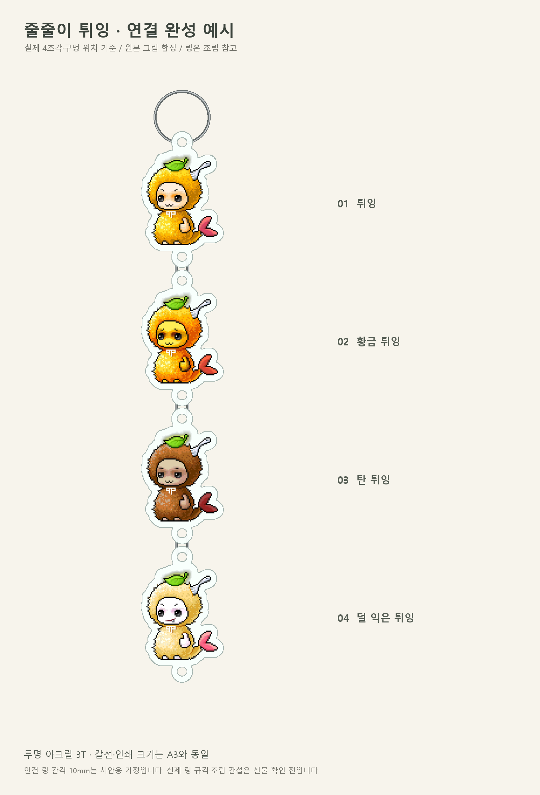

# 현재 제작 파일

**선택 재료 3T · A3 420×297mm · 실제 크기100%. 시험편 없음.**

[이미 인쇄된 500×800mm 판 · 재커팅 전용](recut_only/danbar_500x800) — A3 추가 인쇄 없음. 원본 위치·배율을 유지한 새 칼선입니다.

[개별 에셋 · 원본 방향 AI/PDF·그림·칼선](individual_assets) · [줄줄이 튀잉 완성 예시](individual_assets/linked_tuiing_assembly.png)
기본 파일은 개별 에셋으로 관리합니다. 아래 A3는 출력할 때 쓰는 배치본입니다.

1. [혼합 A3 1 · 추가 이미지·새튀·카데나 판2개 · 41조각](a3_release/02_extra_sheet/3T/sheet_01)
2. [혼합 A3 2 · Len·튀잉·카데나 나머지3개 · 15조각](a3_release/05_len/3T/sheet_01)
3. [어센트 · 카데나 제외 · 별도 A3 2장 / 25조각](a3_release/11_ascent_remaining)

현재 확정분 **A3 4장 / 81조각**. 기존 혼합2장56조각 + 별도 어센트2장25조각입니다. 어센트의 카데나와 무인쇄 패널31은 새 두 장에서 제외했습니다. [전체 안내·두께별 대안·검사](a3_release)

별도 선택안: [새 Len PAD · 7조각 / A3 1장](a3_release/06_len_pad/3T/sheet_01).

별도 선택안: [양검(yanggum) SD 스탠드+키링 결합판 · 캐릭터+받침+키링 3조각 / A3 1장](a3_release/09_yanggum/3T/sheet_01). 제공 원본 그림을 그대로 인쇄합니다.

[이전 파일·원본 백업(raw)](https://github.com/ark1st/dpbr_goods/tree/raw) · [main 소스](https://github.com/ark1st/dpbr_goods/tree/main)

[칼선 전수 검사](LASER_PATH_AUDIT.json) · [전체 제작 검사](RELEASE_VALIDATION.json) · [저장소·보존 검사](REPOSITORY_AUDIT.json) · [퇴역 기록](RETIRED.json)

실물 재단·끼움·인쇄 정합은 미검증입니다. 5T는 대안이며 현재3T와 함께 출력하지 않습니다.
