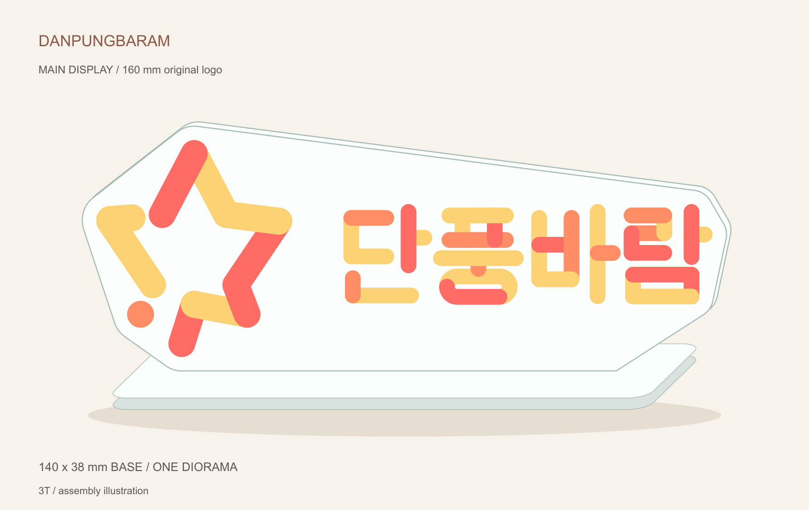
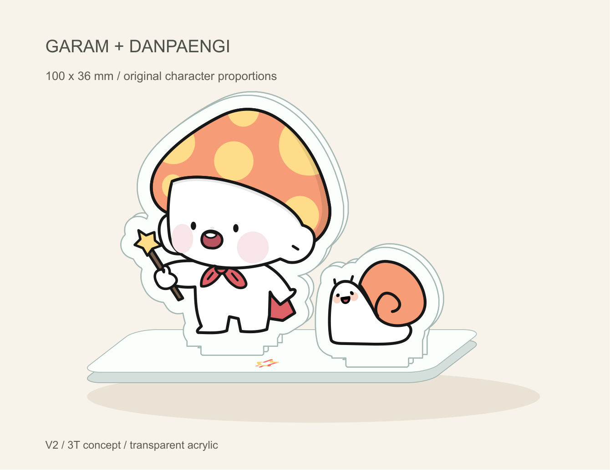
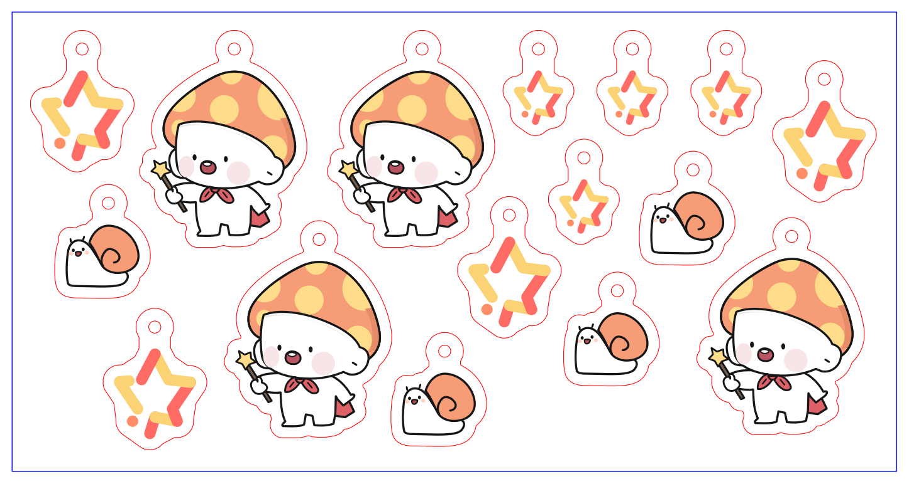

# 출력 파일

## 메인 로고 디오라마 V2 · 2026-11-20

**한 디자인, 1세트2조각**: 단풍바람 로고판1개 + 투명 받침대1개.
받침대140×38mm, 로고 그림160×56.33mm. 기존 로고보다 가로·높이 약1.67배 확대했습니다. 원본 AI의 심벌과 제목 벡터·색상·비율을 유지했습니다.

- [제작 파일과 사용법](logo_diorama_v2/README.md)
- [전체 ZIP](Danpungbaram_Logo_Diorama_V2_MAIN_3T_5T.zip)
- [조립·치수 안내서](logo_diorama_v2/00_ASSEMBLY_GUIDE.pdf)
- [3T 파일](logo_diorama_v2/3T) / [5T 파일](logo_diorama_v2/5T): 둘 중 한 종류만 선택.

실물 끼움은 시험 전입니다. 동봉 시험판으로 실제 홈 너비를 선택한 뒤 제작합니다.

이전96mm 소형 시안은 `logo_diorama_v1`에 보관했습니다. 메인 장식은 V2 파일로 제작하세요.

## 끼움형 디오라마 V2 · 2026-11-20

가람·단팽이·받침대 각1개, **1세트3조각**입니다. 3T와5T는 두께별 대안입니다.
받침대**100×36mm**로 V1보다 면적을 약54% 줄였습니다. 공통18mm 돌기를 사용합니다.
원본 카드의 가로세로·상대 높이 비율을 적용하고 가람 갓 그림자와 단팽이 눈을 수정했습니다.

- [3T/5T 제작 파일 및 사용법](diorama_v2/README.md)
- [전체 ZIP](Danpungbaram_Diorama_V2_3T_5T.zip)
- [조립·치수 안내서](diorama_v2/00_ASSEMBLY_GUIDE.pdf)
- [3T 파일](diorama_v2/3T) / [5T 파일](diorama_v2/5T)

실물 끼움은 시험 전입니다. 포함된9개 홈 시험판으로 해당 재료·장비에 맞는 홈 너비를 먼저 고르세요.
`diorama_v1`과 V1 ZIP은 이전 시안 보관용입니다. 새로 제작할 때는 V2를 사용하세요.

## 아크릴 키링 V3

현재 도안은 **4세트 + 로고 단독 4개 = 총 16조각**입니다.
한 세트는 가람·단팽이·미니 로고 각 1개입니다. 기본 작업영역은 **300×160mm**입니다.
2026-11-19에 원본 카드 대조로 수정한 가람·단팽이 아트워크를 반영해 다시 생성했습니다. 단팽이 완성 외곽은 약 31.1 × 37.7 mm입니다.

빨간 선은 확인용 미리보기에서 보이도록 두껍게 표시했습니다. 실제 커팅 파일은 0.001mm 선입니다.

## 아크릴 키링

- [아크릴 파일 ZIP 다운로드](Danpungbaram_V3_SMALL_BATCH_16pcs.zip)
- [사용 안내서와 실물 크기 시안](production_v3/00_REVISION_GUIDE.pdf)
- [UV 인쇄용 투명 PNG · 300ppi](production_v3/01_PRINT_300ppi.png)
- [Illustrator 원본](production_v3/02_MASTER.ai) / [VectorCraft 원본](production_v3/03_MASTER.vectorcraft)
- [커팅 전용 SVG](production_v3/04_CUT_ONLY.svg) / [커팅 전용 PDF](production_v3/04_CUT_ONLY.pdf)
- [규격 및 간격 검증 결과](production_v3/validation_report.json)

파란 기준선은 위치 맞춤용이며 커팅 대상이 아닙니다. UV 인쇄에는 그림과 파란 선만 사용합니다.
인쇄와 커팅은 **같은 크기·같은 원점, 실제 크기 100%**를 사용합니다.
커팅선은 외곽 16개 + 구멍 16개, 총 32개 폐곡선입니다.

`production_v3/optional_800x600/`은 동일한 16조각을 800×600mm 판 좌표로 옮긴 대안입니다.
기본 파일과 함께 중복 출력하지 않습니다. 안내문의 장비 작업영역은 800×500mm이므로 큰 판을 사용할 수 있는지는 현장에서 확인해야 합니다.

## 밝은색 티셔츠

- [로고 PNG · 300ppi](tshirt/tshirt_logo_70mm_300ppi.png) / [600ppi](tshirt/tshirt_logo_70mm_600ppi.png)
- [Illustrator 원본](tshirt/tshirt_logo_70mm.ai) / [PDF](tshirt/tshirt_logo_70mm.pdf) / [SVG](tshirt/tshirt_logo_70mm.svg)
- [A4 실물 크기 확인용](tshirt/tshirt_70mm_A4_ACTUAL_SIZE.pdf)

이름 없는 로고만 들어 있으며 높이는 70mm입니다. A4 시안의 글자와 확인자는 전사 대상이 아닙니다.

소스 코드와 원본 자료는 [`main` 브랜치](https://github.com/ark1st/dpbr_goods/tree/main)에 있습니다.
