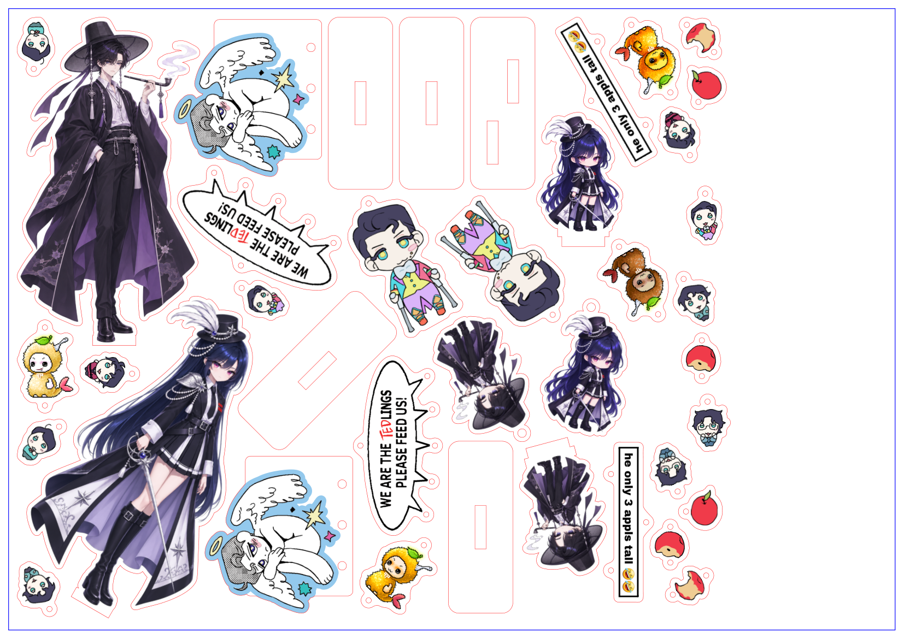

# 혼합 A3 1 · 추가 이미지·새튀·카데나 판2개 · 41조각

[현재 3T 제작 파일](3T/sheet_01) · [선택 대안 5T](5T/sheet_01)

현재3T는41조각(카데나 뒤쪽 판2개 포함), 5T대안은39조각(카데나 제외)입니다. 단팽이·단풍바람 로고 키링은 모두 제외했습니다. 카데나의 나머지3개는 혼합A3 2에 있습니다. 조립 순서는 뒤에서 배경0→효과1→캐릭터2→효과3입니다.

실물 검증 전입니다. [전체 출력 안내](../README.md)
