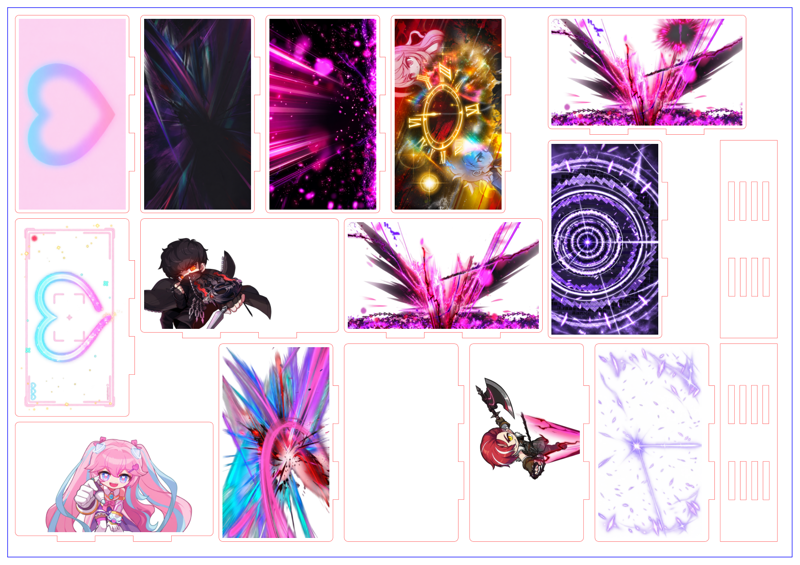
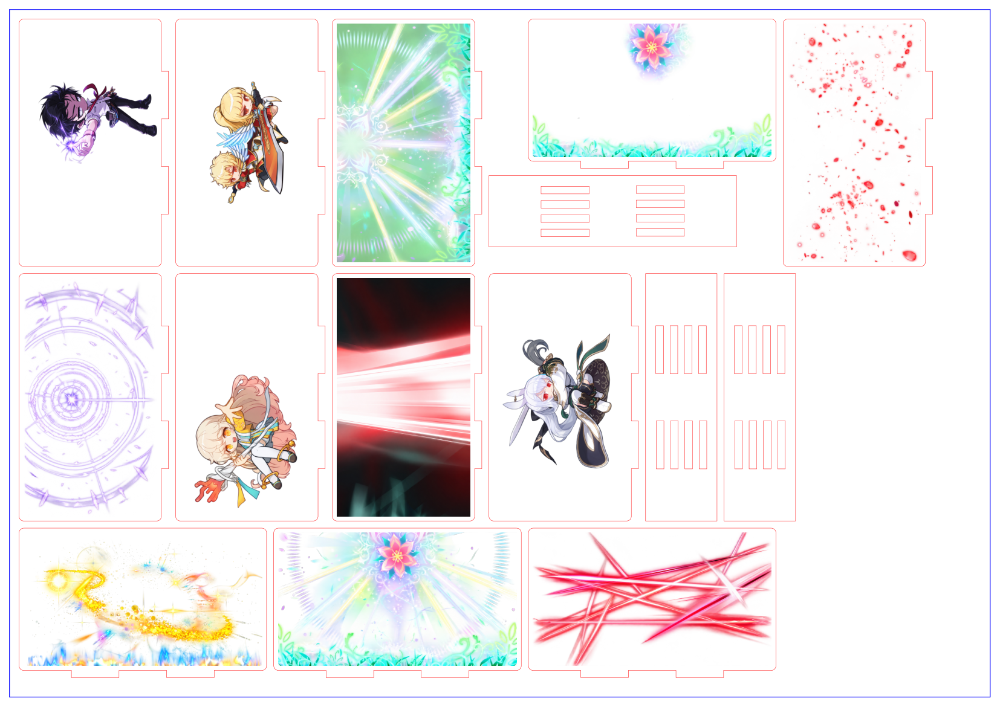

> **퇴역 · 이번 제작에서 사용하지 마세요.** 현재 출력은 카데나5조각만 있는 ../04_ascent_cadena 폴더입니다.

# 4. 어센트 · A3 2장 / 총 31조각

원본 크기 100%. 판 26 + 받침 5. **원본 약 3.2mm 홈을 유지했으며 5T용이 아닙니다.**

- [1번 시트 · 16조각](sheet_01)
- [2번 시트 · 15조각](sheet_02)

좌우 홈의 약 0.195mm 세로 차이는 원본에 있습니다. 임의 수정하지 않았으며, 본 제작 전 끼움 시험을 진행해야 합니다. 비어 있는 효과판 한 개도 원본대로 포함했습니다.

[전체 안내](../README.md)
