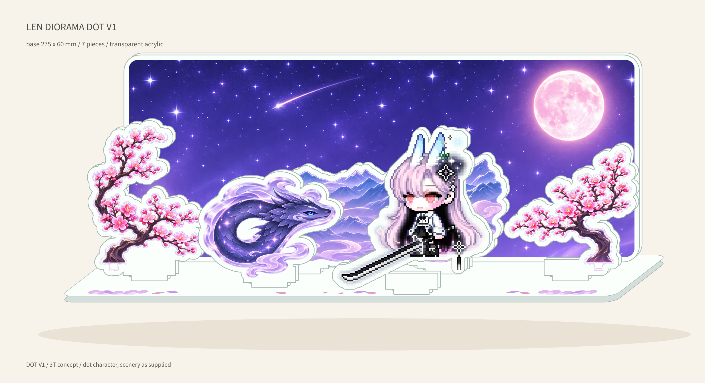

# Len 일반+DOT8 + 시험편2 + 튀잉4 = 14조각

**A3 1장 · 420×297mm · 실제 크기 100%.**

- [3T 제작 파일](3T/sheet_01)
- [5T 제작 파일](5T/sheet_01)

실제 두께에 맞는 한 가지를 선택합니다. 두 버전을 모두 출력하지 않습니다.

공통 배경·받침 **한 세트**에 일반·DOT 캐릭터 두 종류를 교체합니다. 받침275×60mm, 각 캐릭터 원본 그림 높이76mm와 돌기·홈을 유지했습니다.

위 조립 그림은 원격 원본 참고 이미지입니다. 실제 출력 대상은 위 배치도의14조각입니다.

끼움 시험편: 3T 2.6~3.4mm / 5T 4.6~5.4mm, 번호와 인쇄 치수를 확인합니다. 튀잉4개는 이 대지에 있으므로 별도 키링판은 출력하지 않습니다.

[전체 출력 안내](../README.md)
