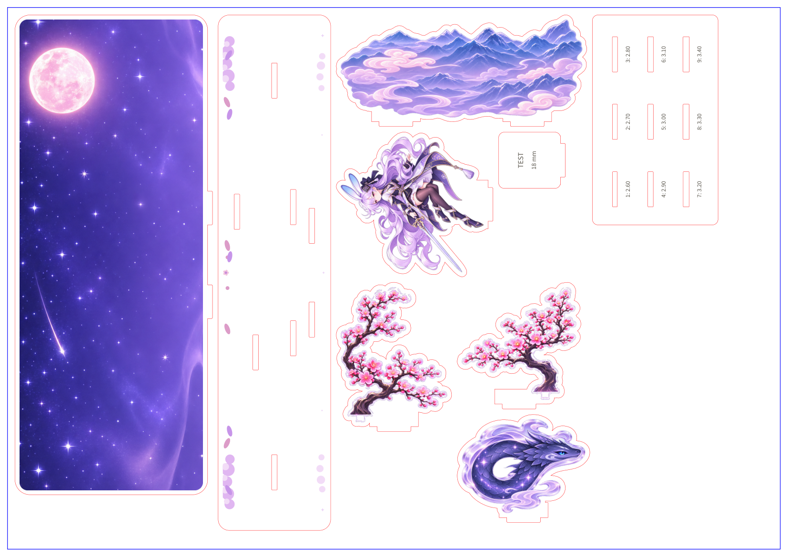

# 5. Len · 본품 7조각 + 시험편 2개

A3 420×297mm / 원본 실제 크기 유지.

- [3T 제작 파일](3T/sheet_01)
- [5T 제작 파일](5T/sheet_01)

실제 재료에 맞는 한 가지를 선택합니다. 두 버전을 모두 출력하는 것이 아닙니다.

[전체 출력 안내](../README.md)

받침 275×60mm, 원본 6개 세움판의 크기·홈 위치를 유지했습니다. 시험편의 각 홈 옆 번호·인쇄 치수를 기준으로 확인합니다. 3T는 2.6~3.4mm, 5T는 4.6~5.4mm입니다.
