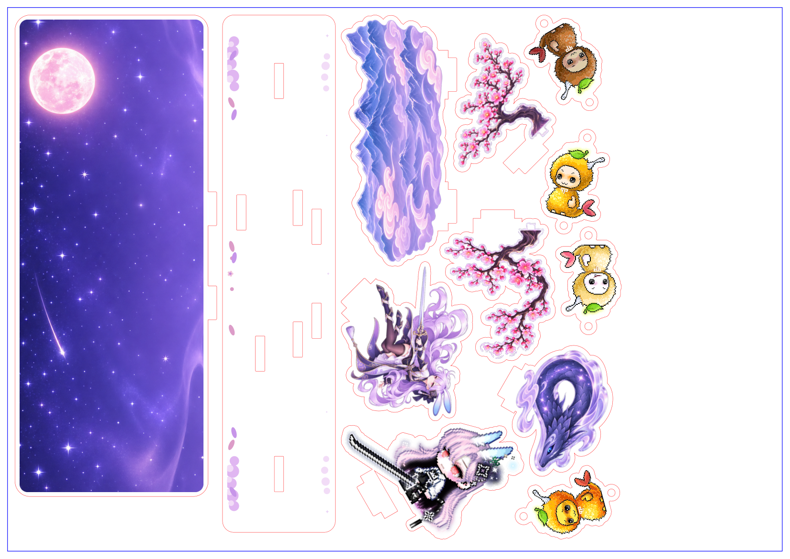

# Len 일반+DOT8 + 튀잉4 = 12조각

**A3 1장 · 420×297mm · 실제 크기 100%.**

- [3T 제작 파일](3T/sheet_01)
- [5T 제작 파일](5T/sheet_01)

실제 두께에 맞는 한 가지를 선택합니다. 두 버전을 모두 출력하지 않습니다.

3T 조각 배치 영역: **398.8×226.3mm**. 실제 외곽을 기준으로 회전 배치했으며 칼선 간격은 3.01mm 이상입니다.

5T 조각 배치 영역: **322.5×278.7mm**. 실제 외곽을 기준으로 회전 배치했으며 칼선 간격은 3.01mm 이상입니다.

공통 배경·받침 **한 세트**에 일반·DOT 캐릭터 두 종류를 교체합니다. 받침275×60mm, 각 캐릭터 원본 그림 높이76mm와 돌기·홈을 유지했습니다.

위 조립 그림은 원격 원본 참고 이미지입니다. 실제 출력 대상은 위 배치도의12조각입니다.

사용자 요청에 따라 시험판·시험키를 모두 제외했습니다. 별도 시험편 파일도 만들지 않습니다. 튀잉4개는 이 대지에 있으므로 별도 키링판은 출력하지 않습니다.

[전체 출력 안내](../README.md)
