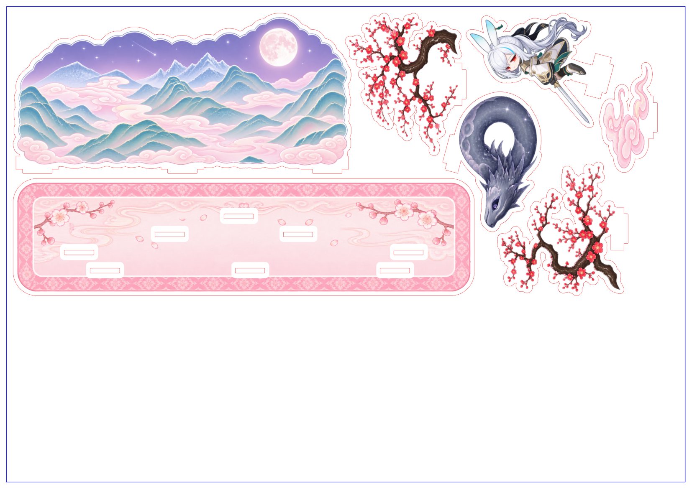

# Len PAD · 출력 보류 · 원본 7조각 보존

[보류된 3T 원본 배치](3T/sheet_01) · [보류된 5T 대안](5T/sheet_01)

**출력 보류입니다. 이 폴더와 ZIP은 원본 배치 참고용이며 현재4장 출력에 추가하지 않습니다.** 받침280×71.2235mm, 파츠6개, 홈8개. 그림·홈·돌기는 원본 크기이며 시험편 없음.

뒤→앞: 별밤·산맥 배경 → 매화 좌·우 → 용·캐릭터 → 분홍 구름.

실물 검증 전입니다. [전체 출력 안내](../README.md)
