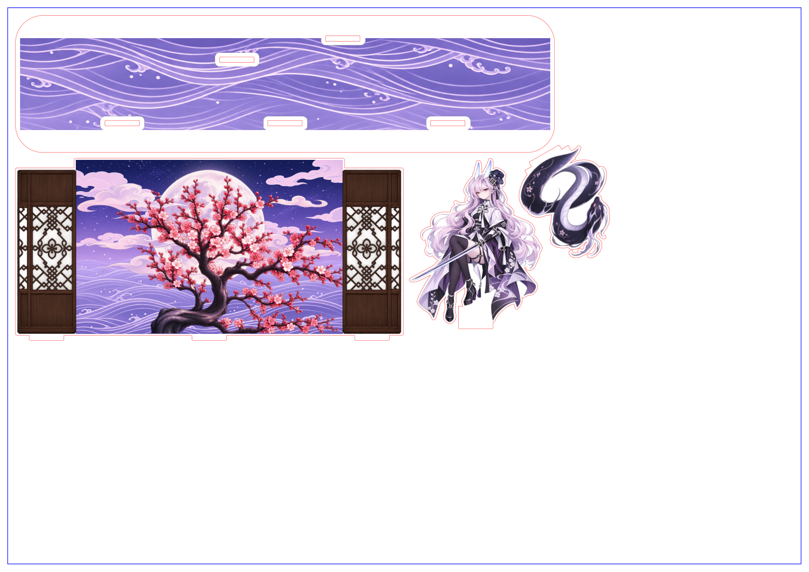
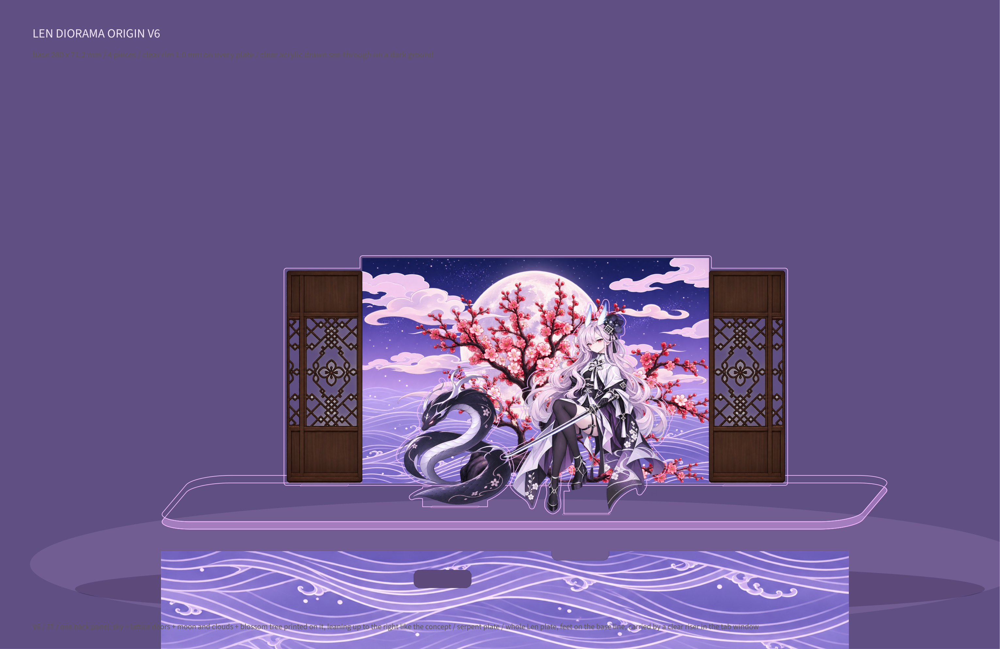

# Len ORIGIN · 별도 선택안 4조각

[현재 3T 제작 파일](3T/sheet_01) · [선택 대안 5T](5T/sheet_01)

별도 세트입니다. 현재 확정2장에 자동 추가하지 않습니다. 받침280×71.2235mm, 파츠3개, 홈5개, 투명 테두리1.0mm(모든 판 동일). 그림·홈·돌기는 원본 크기이며 시험편 없음.

뒤→앞: 하늘·창문 좌우·달구름·대각선 매화(시안처럼 왼쪽 아래에서 오른쪽 위로)를 인쇄한 뒷판 1장 → 뱀 → 받침에 앉은 렌(그림 전체, 다리·부츠·칼 포함). 조립 시안은 투명 아크릴을 투명하게 그립니다.

V6 구도(V4 디자인 + 소유자의 V5 피드백 2건): 렌 84mm 그림(300ppi)을 V4 위치(x=170mm, 앞행 12)에서 잘라내지 않고 통째로 보여줍니다. 긴 쪽 부츠 바닥이 받침 윗면 1.1mm(투명 테두리 1.0mm), 다른 부츠가 1.8mm, 칼끝이 3.1mm에 있어 다리가 받침까지 내려온 앉은 자세입니다. 발밑 돌기 창에서 실루엣이 12mm 하중경로 하한보다 좁으므로 bud-guard가 다리 사이(홈 중심 x=170mm)에 폭 12.25mm 투명 리서를 홈 선 위 9.12mm까지 세웠습니다(인쇄 없음, 엉덩이 아래 유일한 지지). 뱀 55mm는 V4 위치(x=115mm, 뒷행 23) 그대로입니다. 매화는 V4처럼 뒷판 하늘에 인쇄했습니다(칼선·테두리·홈 없음): 100mm 그림(원본 251ppi, 251ppi 원본 픽셀로 삽입)을 원본 해상도에서 시계방향 35° 돌려(x=92–209mm, 받침 위 0–82mm) 줄기가 뱀 등 뒤 x≈130mm에서 시작해 꽃잎이 달(지름 58mm)을 가로질러 오른쪽 위로 뻗어 렌 머리 위와 오른쪽 문 앞까지 이어집니다(앞 판에 가려지지 않는 비율 35.7%, 달 가면 61.6%). V4 빌더는 rotate_deg를 시계반대방향으로 적용해 나무가 반대로 기울어 있었으므로 V6에서 부호를 고쳤습니다.

실물 검증 전입니다. [전체 출력 안내](../README.md)
