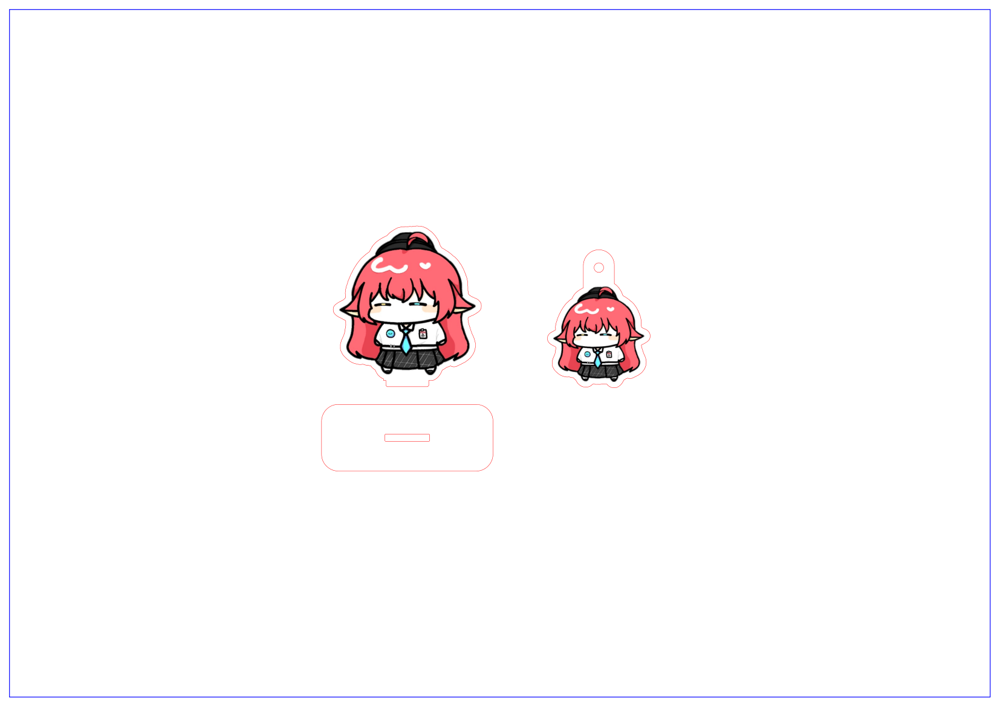
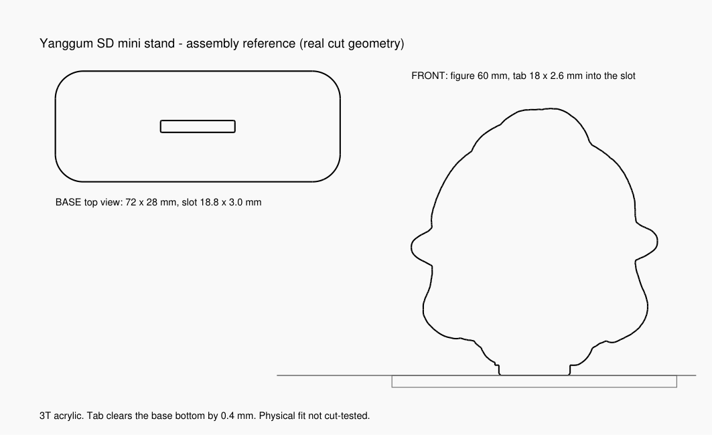

# 양검 SD 스탠드+키링 · 단독 배치 참고용

[단독 배치 참고 파일 · 추가 출력하지 않음](3T/sheet_01)

**단독 배치 참고용입니다. 양검 3조각은 혼합 A3 1·2에 포함되어 있으므로 이 대지를 추가 출력하지 않습니다.** 스탠드: 제공 원본 그림을 그대로 인쇄, 그림 높이 60mm, 컷 62.2×67.5mm. 받침 72×28mm(모서리 R7)는 인쇄 잉크가 없는 투명 아크릴이며, 발 아래 탭 18mm 폭·삽입깊이 2.6mm가 받침 홈 18.8×3.0mm에 끼워집니다. 키링: 그림 높이 40mm, 컷 43.1×58.0mm, 머리 위 캐리어(폭 13mm)에 ⌀4mm 구멍, 구멍까지 그림 6mm·칼선 4.5mm 여유. 줄줄이 키링 8종과는 별개입니다. 5T 대안은 아직 만들지 않았습니다.

실물 검증 전입니다. [전체 출력 안내](../README.md)
