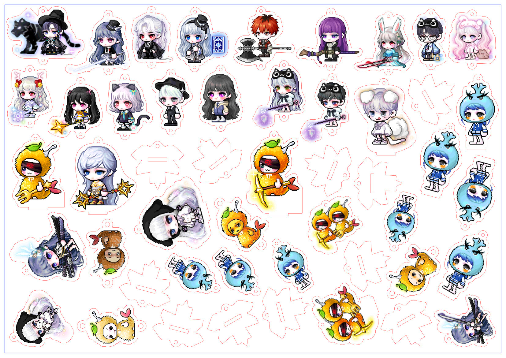

# 3페이지 · 사용자 고정 원본 + 자투리 추가

기존26조각/73폐곡선과 그림·파란 기준선은 원본 좌표 그대로입니다. 렘샤·적매화검·마가다락방 제로 합본은 스탠드와 일반 키링이 각각 하나씩 들어갑니다. 무한이는 스탠드 세 세트와 일반 키링 네 개입니다. 일반 키링에는 위쪽에 지름 2.5mm 구멍이 하나씩 있습니다.

인쇄소에는 [3페이지 인쇄 PNG와 칼선 AI](../../../../print_delivery/page03)를 함께 전달하세요. 100% 배율로 파란 외곽선을 맞추고 빨간 레이어만 재단합니다. 이 폴더에는 편집 원본이 있습니다. 백색이 없는 그림은 RIP에서 백색 설정이 필요합니다.

원본에 있던3쌍의3mm 미만 간격 및8개의8mm 미만 여백은 변경하지 않았고 validation.json에 따로 기록했습니다. 추가 도안의 간격은3mm 이상, 여백은8mm 이상입니다. 별받침·고리·돌기는 원본 벡터복제, 새 캐릭터 외곽은 실측 여백과 곡선 형태를 재현했습니다. 원본 제작프로그램의 작업 이력을 복원한 것은 아닙니다. 실제 가공·끼움은 미검증입니다.
