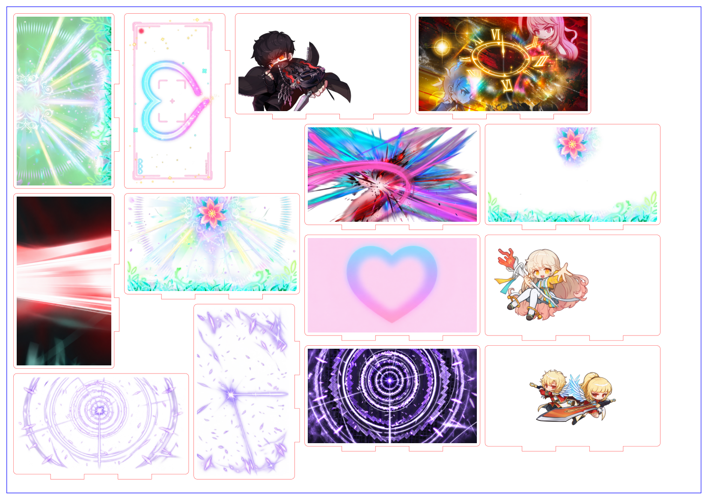
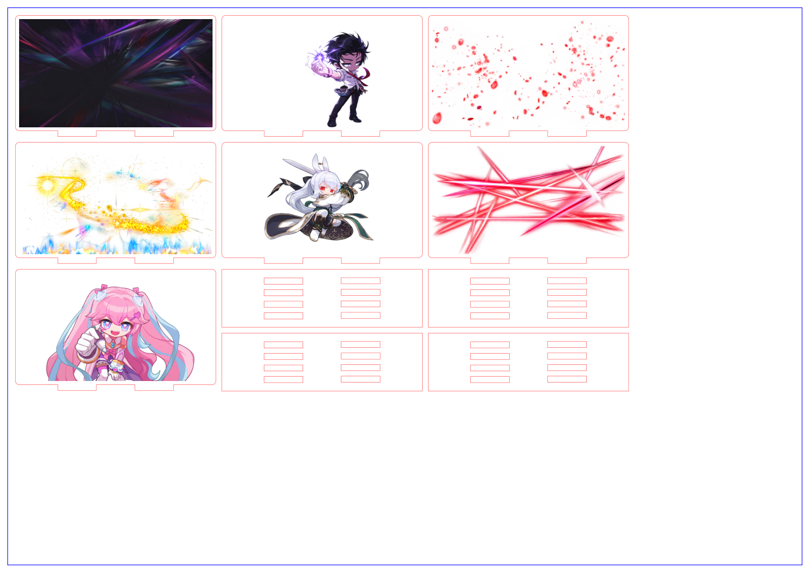
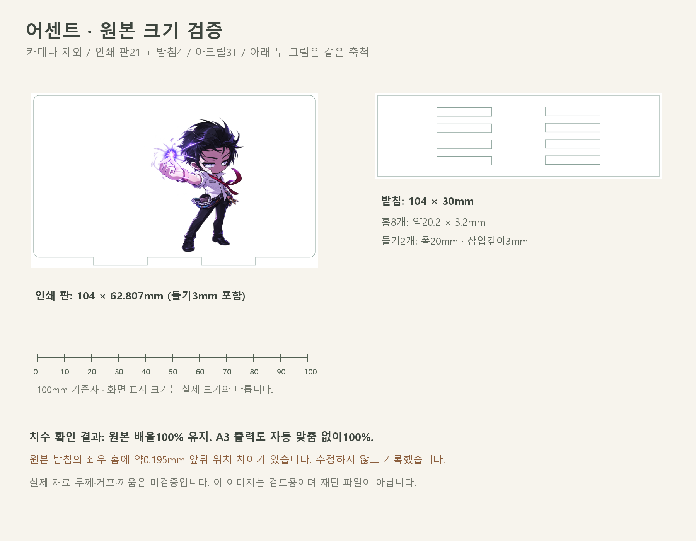

# 어센트 · 카데나 제외 · 별도 A3 2장 · 25조각

[별도 A3 1 · 14조각](3T/sheet_01) · [별도 A3 2 · 11조각](3T/sheet_02)

카데나5조각은 기존 혼합판에 있으며 이 두 장에는 없습니다. 원본의 무인쇄 패널31은 사용자 요청으로 제외했습니다. 인쇄 판21개와 받침4개를 원래 크기로 배치했습니다.

**크기 확인:** 판104×62.807mm(돌기3mm 포함), 받침104×30mm. 홈 약20.2×3.2mm, 돌기2개 각폭20mm·깊이3mm. 실물3T 두께와 끼움은 미검증입니다. 원본의 좌우 홈 앞뒤 차이 약0.195mm도 보존했습니다.

[25조각 치수·발견 사항](SIZE_VERIFICATION.json) · [개별 에셋](../../individual_assets)

실물 검증 전입니다. [전체 출력 안내](../README.md)
