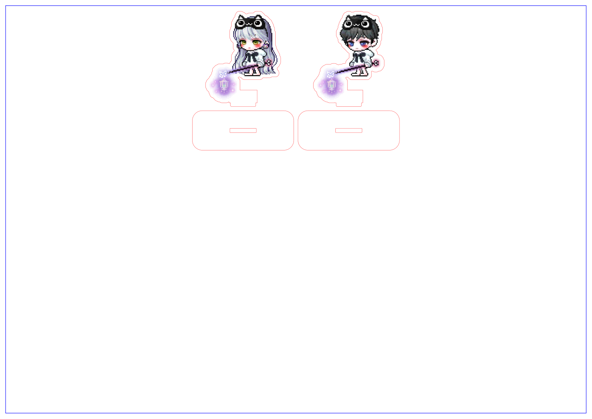
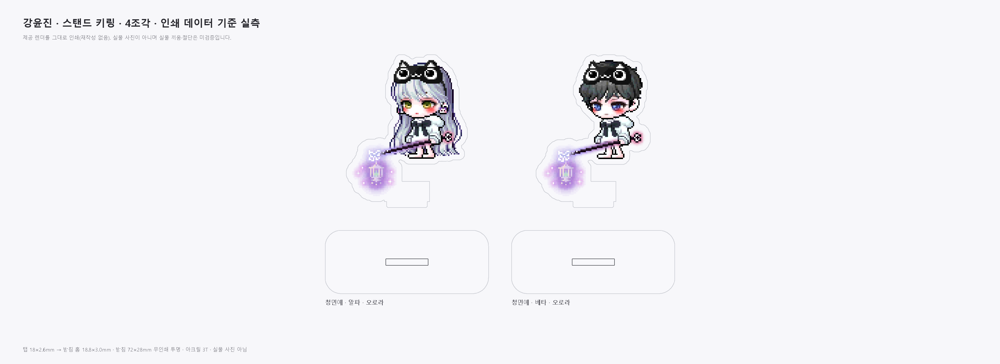

# 강윤진 · 스탠드 키링 · 4조각

[현재 3T 제작 파일](3T/sheet_01)

수요조사 신청 품목(캐릭터 스탠드 키링 6×6cm)의 조각입니다. 캐릭터 그림 높이 60mm, 발 아래 탭 18mm 폭·삽입깊이 2.6mm가 받침 72×28mm(모서리 R7)의 홈 18.8×3.0mm에 끼워집니다. 받침은 무인쇄 투명 아크릴입니다. 제로 캐릭터는 알파·베타 두 모드 스탠드가 모두 포함됩니다.

실물 검증 전입니다. [전체 출력 안내](../README.md)
