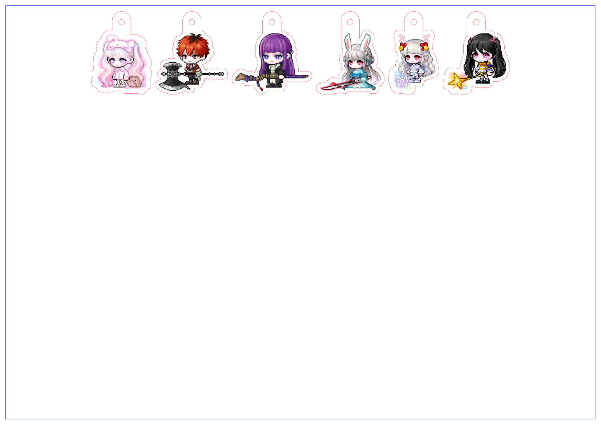
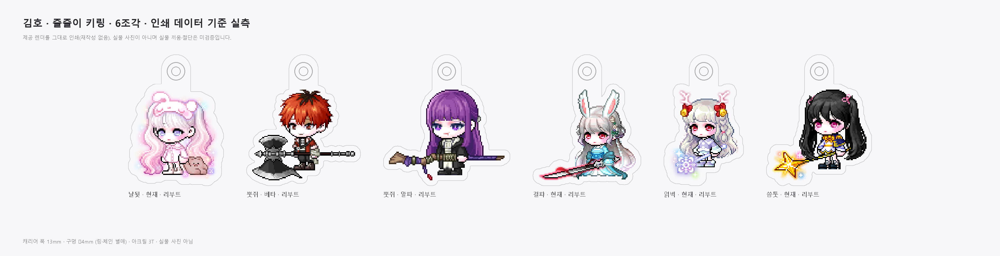

# 김호 · 줄줄이 키링 · 6조각

[현재 3T 제작 파일](3T/sheet_01)

수요조사 신청 품목(캐릭터 줄줄이 키링 4×4cm)의 조각입니다. 그림 높이 40mm, 캐리어 폭 13mm, 구멍 ⌀4mm — 구멍까지 그림 6mm·칼선 4.5mm 여유. 조각마다 구멍이 있어 링·체인으로 연결하며 링은 별매입니다. 제로 캐릭터는 알파·베타 두 모드 조각이 모두 포함됩니다. 인쇄 원본은 공식 look 렌더(render300)를 재작성 없이 그대로 인쇄합니다.

실물 검증 전입니다. [전체 출력 안내](../README.md)
