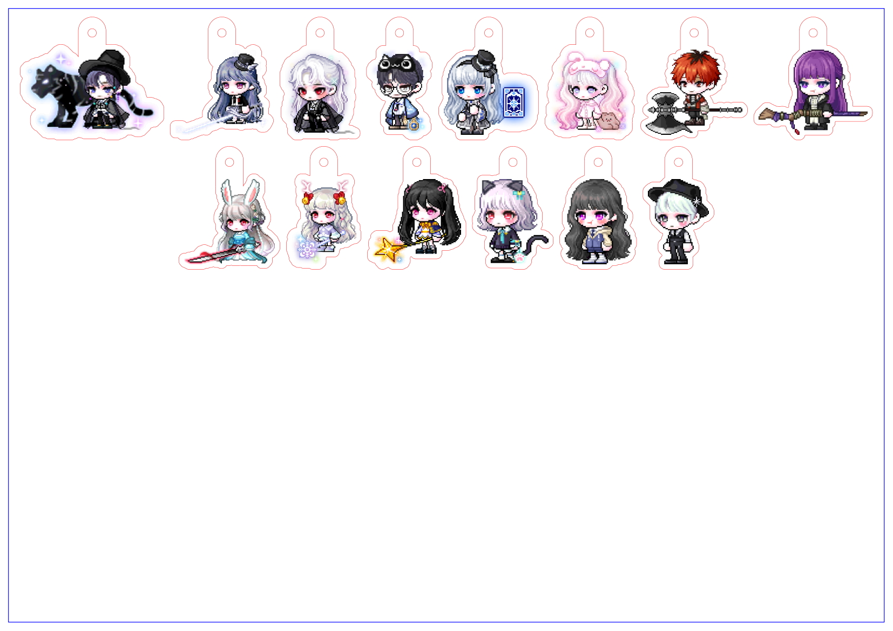

# A3 · 14조각

420×297mm / 실제 크기 100% / 자동 맞춤 해제.

- `01_PRINT.pdf` 또는 `01_PRINT_300ppi.png`: 인쇄·파란 기준선.
- `02_MASTER.ai`, `.pdf`, `.vectorcraft`: 레이어별 편집 원본.
- `03_CUT_ONLY.pdf` 또는 `.svg`: 재단 전용, 빨강 0.001mm.
- `04_WHITE_INK_MASK`: 원본 제공 백색만 보존. 없는 그림은 RIP에서 백색 설정.
- `PREVIEW_NOT_FOR_CUT.pdf`, `preview.png`, `cut_detail.png`: 검토용, 재단 금지.

외곽 14개 / 전체 폐곡선 28개. 그림·홈·구멍 배율 1:1.
파란 기준 사각형은 자르지 않습니다. 인쇄·재단 모두 같은 대지 원점을 사용합니다.
실물 정합·끼움·절단은 아직 시험하지 않았습니다.
