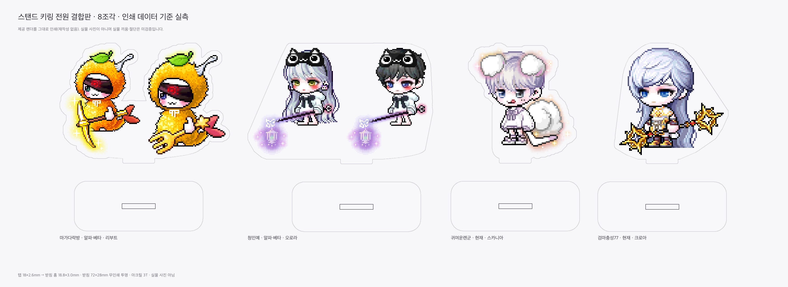

# A3 제작 파일 · 개인별 스탠드·상하 연결 키링

**3T · A3 420×297mm · 실제 크기 100% · 5장 / 134조각.**

기존 84조각의 위치·크기·칼선은 유지했습니다. 보강한 개인별 스탠드 8조각과 상하 연결 키링 5개를 기존 어센트 대지의 자투리에 넣고, 나머지 키링 9개와 Len PAD 7조각은 남은 공간에 배치했습니다. Len PAD는 출력 A3 5번에 포함됩니다. 양검 3조각도 기존 혼합판에 들어 있어 별도 원본판을 중복 출력하지 않습니다. 5장 배치는 검증했지만 더 적은 장수가 불가능하다고 증명한 것은 아닙니다.

3~5번 판의 남는 공간에 원본 그림 크기의 단바 로고 키링 21개를 추가했습니다. 로고 외곽은 크게 단순화하고 원본 구멍을 유지했습니다. 각 판의 수량은 아래 표를 따릅니다.

| 출력 순서 | 제작 폴더 | 조각 |
|---|---|---:|
| 1 | [02_extra_sheet/3T · sheet_01](02_extra_sheet/3T/sheet_01) | 43 |
| 2 | [05_len/3T · sheet_01](05_len/3T/sheet_01) | 16 |
| 3 | [11_ascent_remaining/3T · sheet_01](11_ascent_remaining/3T/sheet_01) | 18 |
| 4 | [11_ascent_remaining/3T · sheet_02](11_ascent_remaining/3T/sheet_02) | 24 |
| 5 | [19_personal_fill/3T · sheet_01](19_personal_fill/3T/sheet_01) | 33 |

## 제작 파일

- `01_PRINT.pdf` 또는 `01_PRINT_300ppi.png`: 인쇄. 파란 위치 기준선 포함.
- `03_CUT_ONLY.pdf` 또는 `.svg`: 재단 전용, 빨강 0.001mm. 안쪽 구멍·홈부터 자릅니다.
- `02_MASTER.pdf`, `.ai`, `.vectorcraft`: 편집본. AI는 PDF 호환 레이어이며 네이티브 편집은 VectorCraft를 사용합니다.
- `04_WHITE_INK_MASK`: 제공된 백색판만 유지합니다. 신규 개인별 도안의 백색은 RIP에서 그림 알파 기준으로 설정해야 합니다.
- `preview.png`, `PREVIEW_NOT_FOR_CUT.pdf`: 검토용입니다.

대지·파란 사각 기준선(가장자리에서 4mm)은 그대로입니다. 조각 간격 3mm 이상, 가장자리 8mm 이상이며 인쇄·백색·칼선의 원점과 배율이 같습니다. 파란 기준선은 자르지 않습니다.

## 개인별 스탠드와 줄줄이 키링

스탠드는 강민·강윤진·이상준·정지영 각각 캐릭터 판 1개와 받침 1개, 총 4세트·8조각입니다. 마가다락방과 청민예는 각각 알파·베타 원본 두 개를 한 판에 함께 인쇄합니다. 각 그림의 높이 60mm와 원래 비율은 그대로이며 합본 외곽 폭은 약95mm·103mm입니다.
몸통 중심 아래에 캐릭터당 폭26mm의 투명 보강부를 연결했습니다. 넓은 지지부가 부드러운 곡면으로 폭18mm 돌기에 이어지며, 무기 효과 쪽의 얇은 길에만 의존하지 않습니다. 탭18×2.6mm, 받침72×28mm, 홈18.8×3.0mm는 유지합니다. 자동 검사는 연속 지지 폭과 접합 면적을 확인하며 실제 강도 시험은 아닙니다.
줄줄이 키링 14개 모두 위·아래 ⌀4mm 연결 구멍이 있습니다. 기존 그림 높이 40mm와 상단 연결부를 유지하고 아래 연결부를 추가해 완성 높이는 약71mm입니다. 4×4cm 완성 외곽으로 축소한 파일이 아닙니다.
연결 금속 링·체인은 제작 칼선에 포함하지 않습니다. 링·체인의 실제 조립 간섭과 아크릴 끼움·커프·인쇄 정합은 실물 미검증입니다.

| 개인별 부품 ID | 출력 A3 |
|---|---:|
| len_pad_3T_01_safe | 5 |
| len_pad_3T_02_safe | 5 |
| len_pad_3T_03_safe | 5 |
| len_pad_3T_04 | 5 |
| len_pad_3T_05_safe | 5 |
| len_pad_3T_06 | 5 |
| len_pad_3T_07 | 5 |
| 강민_stand_01 | 4 |
| 강민_stand_02 | 4 |
| 강윤진_stand_01 | 4 |
| 강윤진_stand_02 | 4 |
| 김윤_keyring_01 | 5 |
| 김윤_keyring_02 | 5 |
| 김윤_keyring_03 | 5 |
| 김윤_keyring_04 | 4 |
| 김윤_keyring_05 | 5 |
| 김호_keyring_01 | 3 |
| 김호_keyring_02 | 5 |
| 김호_keyring_03 | 5 |
| 김호_keyring_04 | 5 |
| 김호_keyring_05 | 5 |
| 김호_keyring_06 | 5 |
| 배승민_keyring_01 | 4 |
| 배승민_keyring_02 | 4 |
| 배승민_keyring_03 | 4 |
| 이상준_stand_01 | 4 |
| 이상준_stand_02 | 4 |
| 정지영_stand_01 | 4 |
| 정지영_stand_02 | 4 |

Len PAD의 원래 크기와 280×71.2235mm 받침·8개 홈을 유지했습니다. `06_len_pad`의 단독판은 원본 참고용이며 위 출력 순서에 더해 인쇄하지 않습니다.

이번 출력에는 ZIP을 새로 만들지 않았습니다. 남아 있는 이전 ZIP은 이전 버전의 보관 파일이며 현재 제작용이 아닙니다. 현재 시트 폴더의 파일을 사용하세요.

[배치 검사](A3_VALIDATION.json) · [개인 도안 추가 기록](PERSONAL_FILL_ASSESSMENT.json) · [칼선 검사](../LASER_PATH_AUDIT.json) · [개별 편집 에셋](../individual_assets)
