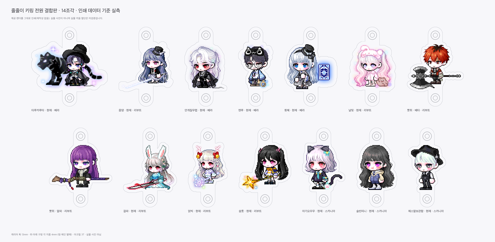

# A3 제작 파일 · 개인별 스탠드·상하 연결 키링

**3T · A3 420×297mm · 실제 크기 100% · 5장 / 110조각.**

기존 84조각의 위치·크기·칼선은 유지했습니다. 개인별 스탠드 12조각과 상하 연결 키링 2개를 기존 어센트 대지의 자투리에 넣고, 나머지 키링 12개는 A3 한 장에 모았습니다. 5장 배치는 검증했지만 4장 배치가 불가능하다고 증명한 것은 아닙니다. Len PAD는 계속 출력 보류이며 양검 단독판은 중복 참고본입니다.

| 출력 순서 | 제작 폴더 | 조각 |
|---|---|---:|
| 1 | [02_extra_sheet/3T · sheet_01](02_extra_sheet/3T/sheet_01) | 43 |
| 2 | [05_len/3T · sheet_01](05_len/3T/sheet_01) | 16 |
| 3 | [11_ascent_remaining/3T · sheet_01](11_ascent_remaining/3T/sheet_01) | 15 |
| 4 | [11_ascent_remaining/3T · sheet_02](11_ascent_remaining/3T/sheet_02) | 24 |
| 5 | [19_personal_fill/3T · sheet_01](19_personal_fill/3T/sheet_01) | 12 |

## 제작 파일

- `01_PRINT.pdf` 또는 `01_PRINT_300ppi.png`: 인쇄. 파란 위치 기준선 포함.
- `03_CUT_ONLY.pdf` 또는 `.svg`: 재단 전용, 빨강 0.001mm. 안쪽 구멍·홈부터 자릅니다.
- `02_MASTER.pdf`, `.ai`, `.vectorcraft`: 편집본. AI는 PDF 호환 레이어이며 네이티브 편집은 VectorCraft를 사용합니다.
- `04_WHITE_INK_MASK`: 제공된 백색판만 유지합니다. 신규 개인별 도안의 백색은 RIP에서 그림 알파 기준으로 설정해야 합니다.
- `preview.png`, `PREVIEW_NOT_FOR_CUT.pdf`: 검토용입니다.

대지·파란 사각 기준선(가장자리에서 4mm)은 그대로입니다. 조각 간격 3mm 이상, 가장자리 8mm 이상이며 인쇄·백색·칼선의 원점과 배율이 같습니다. 파란 기준선은 자르지 않습니다.

## 개인별 스탠드와 줄줄이 키링

스탠드는 강민 4조각, 강윤진 4조각, 이상준 2조각, 정지영 2조각입니다. 캐릭터 6개와 투명 받침 6개이며 탭 18×2.6mm, 받침 홈 18.8×3.0mm입니다.
줄줄이 키링 14개 모두 위·아래 ⌀4mm 연결 구멍이 있습니다. 기존 그림 높이 40mm와 상단 연결부를 유지하고 아래 연결부를 추가해 완성 높이는 약71mm입니다. 4×4cm 완성 외곽으로 축소한 파일이 아닙니다.
연결 금속 링·체인은 제작 칼선에 포함하지 않습니다. 링·체인의 실제 조립 간섭과 아크릴 끼움·커프·인쇄 정합은 실물 미검증입니다.

| 개인별 부품 ID | 출력 A3 |
|---|---:|
| 강민_stand_01 | 4 |
| 강민_stand_02 | 4 |
| 강민_stand_03 | 4 |
| 강민_stand_04 | 4 |
| 강윤진_stand_01 | 4 |
| 강윤진_stand_02 | 4 |
| 강윤진_stand_03 | 4 |
| 강윤진_stand_04 | 4 |
| 김윤_keyring_01 | 4 |
| 김윤_keyring_02 | 5 |
| 김윤_keyring_03 | 5 |
| 김윤_keyring_04 | 5 |
| 김윤_keyring_05 | 5 |
| 김호_keyring_01 | 3 |
| 김호_keyring_02 | 5 |
| 김호_keyring_03 | 5 |
| 김호_keyring_04 | 5 |
| 김호_keyring_05 | 5 |
| 김호_keyring_06 | 5 |
| 배승민_keyring_01 | 5 |
| 배승민_keyring_02 | 5 |
| 배승민_keyring_03 | 5 |
| 이상준_stand_01 | 4 |
| 이상준_stand_02 | 4 |
| 정지영_stand_01 | 4 |
| 정지영_stand_02 | 4 |

이번 출력에는 ZIP을 새로 만들지 않았습니다. 남아 있는 이전 ZIP은 이전 버전의 보관 파일이며 현재 제작용이 아닙니다. 현재 시트 폴더의 파일을 사용하세요.

[배치 검사](A3_VALIDATION.json) · [개인 도안 추가 기록](PERSONAL_FILL_ASSESSMENT.json) · [칼선 검사](../LASER_PATH_AUDIT.json) · [개별 편집 에셋](../individual_assets)
