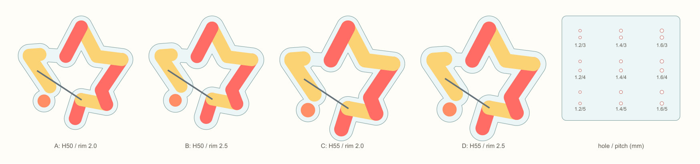

# 단풍바람 카라비너 샘플 4종 + 구멍 시험편

| 샘플 | 몸체 높이 | 일반 투명 여백 |
|---|---:|---:|
| A | 50mm | 2.0mm |
| B | 50mm | 2.5mm |
| C | 55mm | 2.0mm |
| D | 55mm | 2.5mm |

구매한 금속 부품은 **9×23.5×1mm**. 회색 막대는 길이 참고용이며 인쇄·재단 파일에는 없습니다.
왼쪽 아래가 열리는 형태입니다. 5cm 원본 배치에서는 여백2.5mm를 두르면 개방부가 닫히므로,
카라비너용으로만 왼쪽 노란 팔과 주황 점을 왼쪽5mm·위1.5mm 이동했습니다.
원본7개 경로·색상과 각 경로 자체의 비율은 유지합니다. 위쪽 투명 연결부로 하나의 조각이 됩니다.
일반 외곽 여백은 표의 값이며 연결부는 더 넓습니다. 다른 키링과 로고 원본 배치에는 이 변형을 적용하지 않습니다.

**시험용입니다. 금속 부품 장착과 개폐는 실물 검증 전입니다.**
문서에는 부품의 바깥 치수만 있어 두 다리의 구멍 간격·꺾임 깊이를 확정할 수 없습니다.
따라서 본체 장착 부분은 미타공입니다. 시험편으로 지름1.2/1.4/1.6mm와 중심간격3/4/5mm를 비교한 뒤,
본체에 실제 부품을 대고 위치를 표시해 타공합니다. 맞는 조합이 없으면 실측값으로 config를 수정합니다.
시험편의 '1.4/4' 표기는 구멍 지름1.4mm / 중심간격4mm입니다. 커프 보정 전입니다.
23.5mm는 부품 전체 높이이며 유효 회전 길이와 같다고 가정하지 않습니다.
3T·5T 판에 같은 평면 경로를 사용할 수 있지만 부품의 폭·다리 깊이·스프링 예압은 두께마다 확인해야 합니다.
장식용으로만 사용합니다.

- 02_MASTER.ai: 편집용. 빨간 칼선0.001mm.
- 01_PRINT_300ppi.png: 투명 인쇄 파일. 파란 기준 사각형 포함.
- 03_CUT_ONLY.pdf / SVG: 23폐곡선, 5외곽 + 시험편 구멍18개.
- 단바 합본에도 **동일한 샘플5조각**이 들어갑니다. 별도 시트와 중복 제작하지 마세요.

문서의 레진·실리콘 몰드는 다음 제작 방식 검토 항목입니다.
이번 파일은 평판 아크릴 형상·장착 시험용이며 레진 금형 도면이 아닙니다.
