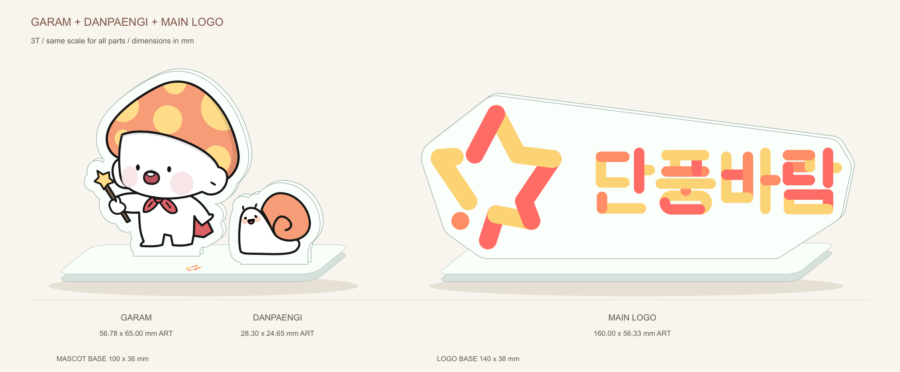
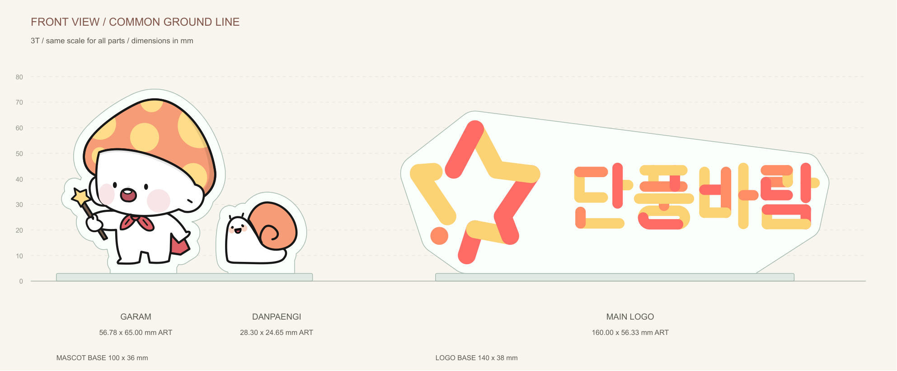

> **보관용 구버전 — 새 제작에 사용하지 마세요.** 칼선 품질 수정은 [현재 제작본](../README.md)에 적용했습니다.

# 가람·단팽이·메인 로고 합본

기존 마스코트 디오라마 V2와 큰 로고 V2를 **그대로, 같은 배율**로 모았습니다.
구성은 가람1 + 단팽이1 + 큰 로고1 + 기존 받침대2 = **총5조각**입니다.
한 개의 공통 받침대로 바꾸지 않았습니다. 마스코트는100×36mm, 로고는140×38mm 받침대에 꽂습니다.
3T와5T는 두께별 대안으로 한 종류만 선택합니다.

| 그림 | 폭×높이(mm) |
|---|---:|
| 가람 | 56.78×65.00 |
| 단팽이 | 28.30×24.65 |
| 제목 포함 큰 로고 | 160.00×56.33 |

비교 그림은 원근 축소가 없는 평행 투영이며 모든 부품의 가로·세로 축척이 같습니다.
정면도는 받침대 바닥선을 맞췄고, 점선 눈금은10mm입니다.
화면 표시 크기는 기기에 따라 달라지지만 세 그림 사이의 실제 제작 비율은 유지됩니다.
그림 치수는 인쇄 부분 기준이며 투명 여백·받침대 두께는 별도입니다.

## Illustrator 파일

- `3T/02_COMBINED_MASTER.ai` / `5T/02_COMBINED_MASTER.ai`: **제작용 합본**. 310×160mm 판에5조각 배치.
- `3T/preview/00_DISPLAY_COMPARISON.ai`: **조립 모습 편집용**. 설명 그림이므로 생산용으로 쓰지 않습니다.
- 각 AI의 `.vectorcraft`, `.svg` 원본도 포함합니다.
- `01_PRINT_300ppi.png`: 그림과 파란 기준선만 있는 투명 UV 인쇄 파일.
- `03_CUT_ONLY.svg`: 빨간0.001mm 재단선. 홈4개를 먼저 자르고 외곽5개를 자릅니다.
- `04_FIT_TEST_*`: 공통18mm 돌기의 홈 너비 시험판.
- `05_UPRIGHTS_ONLY.svg`, `05_BASES_ONLY.svg`: 부품 종류별 확인 파일. 두께가 다르면 별도 두께용 도안으로 생성해야 합니다.

인쇄·재단은 같은 원점과100% 크기를 유지합니다. 파란 사각 기준선은 재단하지 않습니다.
실물 끼움은 시험 전입니다. 기존과 같은18mm 돌기·홈 규격을 유지했으며 같은 재료와 설정으로 시험 후 제작합니다.
`python scripts/build_combined_diorama.py`로 재생성합니다.
