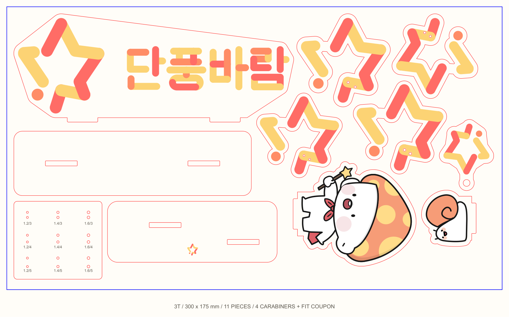
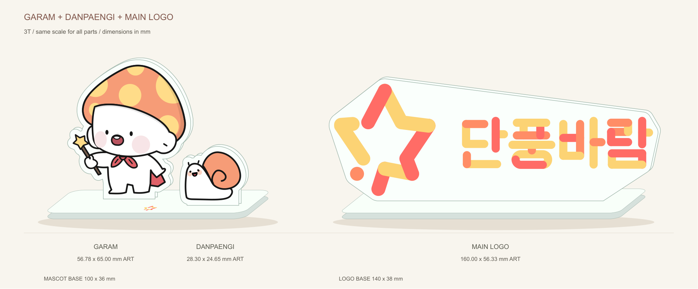
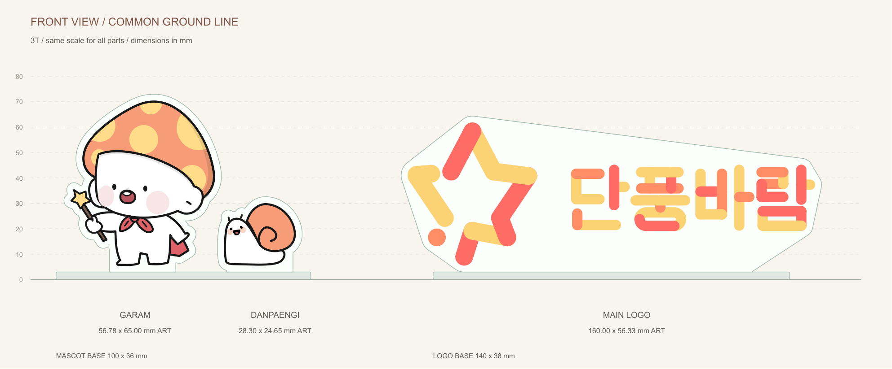

# 가람·단팽이·메인 로고 합본 V3 · 간격 3mm 압축 배치 + 카라비너 레이저 타공

**300×175mm, 총 11조각. 조각 사이 최소 간격 3mm.**
이전 310×205mm보다 대지 면적을 17.4% 줄였습니다.
그림과 부품 크기는 그대로이며 회전·이동만으로 재배치했습니다.
기존6조각(가람·단팽이·큰 로고·받침2·로고 키링)에 카라비너4종과 구멍 시험편1개를 추가했습니다.
3T·5T는 두께별 대안으로 **실제 판 두께에 맞는 한 종류만** 사용합니다.

| 파일 | 용도 |
|---|---|
| 3T/02_COMBINED_MASTER.ai 또는 5T/02_COMBINED_MASTER.ai | Illustrator 편집용 합본 |
| 같은 폴더의 01_PRINT_300ppi.png | UV 인쇄용 투명 PNG |
| 03_CUT_ONLY.pdf / SVG | 빨간0.001mm, 42개 폐곡선 |
| 04_FIT_TEST_* | 디오라마18mm 돌기의 홈 너비 시험판 |
| 05_CARABINERS_ONLY.svg | 합본과 같은 좌표의 카라비너·구멍 시험편만 |
| preview/00_DISPLAY_COMPARISON.ai | 조립 시안 편집용, 제작용 아님 |

**구멍31개(받침 홈4+키링1+카라비너 본체8+시험편18)를 먼저 자르고 외곽11개를 나중에 자릅니다.**
파란 사각형은 위치 기준선입니다. 재단 대상이 아닙니다.
인쇄·재단 모두 원점과100% 크기를 유지하고 자동 맞춤은 끕니다.
작업영역은 안내문의800×500mm 이내입니다.

마스코트와 큰 로고의 그림 크기·원본 비율은 V2와 같습니다.
가람56.78×65mm / 단팽이28.30×24.65mm / 제목 포함 로고160×56.33mm.
받침은100×36mm와140×38mm입니다. 일반 투명 여백2.5mm, 키링 구멍 지름4mm,
구멍-외곽2.5mm, 구멍-그림3mm 기준으로 줄였습니다. 구조 연결부·받침 어깨는 더 넓습니다.

카라비너는 A=50mm/2mm, B=50mm/2.5mm, C=55mm/2mm, D=55mm/2.5mm입니다.
아래쪽 왼편 개방형이며 원본 로고의 왼팔·주황 점만 외측으로 이동한 시험용 변형입니다.
**각 본체에 장착 구멍 2개를 레이저 칼선으로 넣었습니다. 이전 미타공 도안을 대체합니다.**
A=지름1.2/간격4mm, B=1.4/4mm, C=1.6/4mm, D=1.4/5mm입니다.
구멍-외곽 여유는 최소2.5mm 이상입니다. 구멍 주변0.25mm는 인쇄하지 않습니다.
구매 부품9×23.5×1mm의 실제 다리 간격은 미확정이므로 네 조합은 조립 시험용 시작값입니다.
[카라비너 상세 시안과 시험 절차](../carabiner_trials_v1/README.md)의 수치는 미검증 시작값입니다.
독립 카라비너 시트와 이 합본의 샘플은 같습니다. 중복 출력하지 마세요.

실물 끼움·개폐 시험은 아직 하지 않았습니다.
동봉 시험판으로 실제 재료와 장비의 커프를 확인한 뒤 나머지를 가공합니다.
이전 V2는 보관용이며 이번 수정 파일은 V3입니다.
