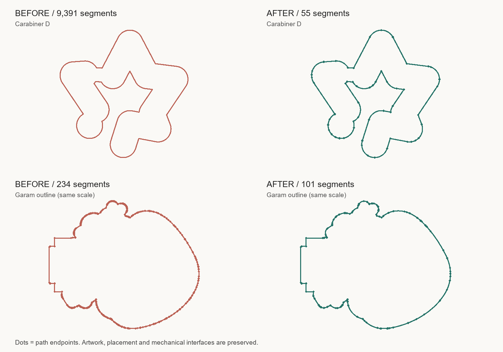

# 칼선 곡선화 수정·전수 검사 · 2026-11-20

**기존에 내려받은 파일은 새 파일로 교체하세요.** 아래 현재 제작판 모두에 수정했습니다.

단바 합본의 직선 선분 44,278개를 3T 625개 / 5T 626개의 직선·곡선으로 정리했습니다.
3T AI/PDF에서 측정한 이전 값은 길이 0 명령 3개가 제거되어 44,275개입니다.
인쇄 PNG 16개는 수정 전과 바이트까지 동일합니다. 그림 크기와 배치, 조각 수를 유지했습니다.
구멍·홈·돌기 치수를 보존하고 폐곡선, 자기교차, 중복, 선분 밀도, 조각 간격을 검사합니다.

| 주요 AI 제작판 | 이전 선분 | 수정 선분 | 최대 외곽 차이(mm) |
|---|---:|---:|---:|
| production_v4/02_MASTER.ai | 34,888 | 1,320 | 0.01832 |
| carabiner_trials_v1/02_MASTER.ai | 41,422 | 325 | 0.01701 |
| diorama_v3/3T/02_MASTER.ai | 651 | 175 | 0.01794 |
| logo_diorama_v3/3T/02_MASTER.ai | 640 | 58 | 0.01502 |
| combined_diorama_v3/3T/02_COMBINED_MASTER.ai | 44,275 | 625 | 0.01795 |
| extra_sheet/3T/05_MASTER.ai | 18,892 | 2,668 | 0.01882 |
| diorama_v3/5T/02_MASTER.ai | 652 | 176 | 0.01794 |
| logo_diorama_v3/5T/02_MASTER.ai | 640 | 58 | 0.01305 |
| combined_diorama_v3/5T/02_COMBINED_MASTER.ai | 44,276 | 626 | 0.01795 |
| extra_sheet/5T/05_MASTER.ai | 18,892 | 2,670 | 0.01882 |
| linked_tuiing_v1/tuiing/02_MASTER.ai | 3,735 | 204 | 0.01801 |
| linked_tuiing_v1/golden/02_MASTER.ai | 3,735 | 204 | 0.01801 |
| linked_tuiing_v1/burnt/02_MASTER.ai | 3,735 | 204 | 0.01801 |
| linked_tuiing_v1/unfried/02_MASTER.ai | 3,735 | 204 | 0.01801 |

현재 칼선 파일 126개(SVG·AI·PDF·VectorCraft)의 전수 검사 결과는 [LASER_PATH_AUDIT.json](../LASER_PATH_AUDIT.json)에 있습니다.
이 보고서의 records에는 각 파일의 해시, 폐곡선·선분·곡선 수, 오류, 조각 간격이 들어 있습니다.
inventory에는 저장소의 이전 제작본·인쇄 전용 자료까지 분류했습니다.

외부 캐릭터 30개 원본은 그대로 유지했습니다. 원본 PDF의 길이 0 명령 2개는 이동이 없는 명령이며,
AI 변환에서 생긴 약0.00003mm 흔적은 수치 반올림입니다. 해당 항목을 별도 기록했습니다.
실제 자기교차나 중복 경로는 원본 도안이어도 배포를 차단합니다.

## 현재 수정본

- [단바 합본 3T / 5T](../combined_diorama_v3/README.md)
- [엑스트라 시트 3T / 5T](../extra_sheet/README.md)
- [마스코트·로고 키링](../production_v4/README.md)
- [마스코트 디오라마](../diorama_v3/README.md)
- [메인 로고 디오라마](../logo_diorama_v3/README.md)
- [카라비너 4종](../carabiner_trials_v1/README.md)
- [연결형 튀잉 4종](../linked_tuiing_v1/README.md)

과거 V1/V2와 이전 키링·합본 ZIP은 보관용입니다. 이번 수정본 링크의 파일을 사용하세요.
실제 장비에서의 개선 시간·절단면과 끼움은 아직 재시험하지 않았습니다.
처음에는 같은 재료로 한 조각을 비교 절단해 주세요.
