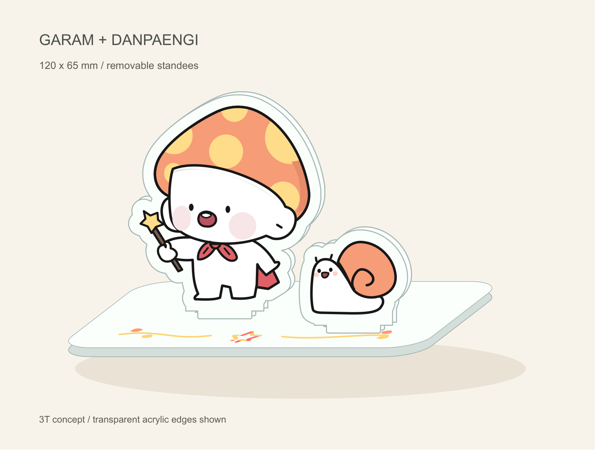

# 가람 + 단팽이 끼움형 디오라마 V1



**본품 1세트 = 받침대 1 + 가람 1 + 단팽이 1, 총 3조각.**
3T와 5T는 같은 세트의 두께별 대안이며, 각 폴더는 1세트 분량입니다.

받침대 120×65mm / 가람 그림 높이65mm / 단팽이24.65mm.
같은 원본 카드의 캐릭터 높이 비율을 유지합니다. 두 캐릭터의 돌기 폭은 공통18mm로 서로 교체할 수 있습니다.
다른 캐릭터는 `05_CHARACTER_TEMPLATE.svg`의 그림과 윗부분 윤곽을 바꾸고 아래 결합부를 유지하세요.

## 먼저 시험 조각

기본 홈 너비3.00/5.00mm는 **절단 경로의 시작값**입니다. 실물 끼움은 아직 시험하지 않았습니다.
같은 판·같은 설정으로 `04_FIT_TEST`를 잘라 맞는 홈을 고른 뒤 본품을 자르세요.
기본 시험 범위: 3T 2.60-3.40mm / 5T 4.60-5.40mm, 0.10mm 간격.
번호는 왼쪽 위부터 가로 방향으로1-9입니다. 숫자 레이어는 커팅 대상이 아닙니다.

- 홈의 짧은 너비: **서 있는 캐릭터 판**의 두께와 시험 결과에 따라 결정.
- 돌기 길이: **받침대**의 실측 두께에서0.40mm 뺀 값. 기본3T 2.60mm /5T 4.60mm.
- 홈 긴 방향18.8mm, 모서리반경0.35mm, 돌기끝 사선0.40mm.
- 돌기와 홈 주변은 인쇄하지 않습니다. 보호필름 제거 후 손으로 시험합니다.
- 본품과 시험판은 별도입니다. 3T/5T 파일을 한꺼번에 출력하지 않습니다.

## 파일

- `00_ASSEMBLY_GUIDE.pdf`: 조립·치수·시험 순서와 A4 실측 확인자.
- 두께별 폴더 `01_PRINT_300ppi.png`: 파란 기준선을 포함한 투명 PNG, 300ppi.
- `02_MASTER.ai` / `.vectorcraft` / `.svg`: 그림, 기준선, 재단선의3개 레이어.
- `03_CUT_ONLY.svg`: 빨간0.001mm 폐곡선5개(홈2+외곽3), 홈을 먼저 자릅니다.
- `04_FIT_TEST_*`: 9개 홈 시험판과18mm 돌기 시험키. 혼합두께이면 BASE/KEY 분리파일을 서로 다른 판에 출력.
- `05_CHARACTER_TEMPLATE.svg`: 다른 캐릭터용 공통 돌기 템플릿. 안내 레이어는 삭제하고 출력.
- `06_BASE_ONLY.svg` / `06_STANDEES_ONLY.svg`: 판 두께를 서로 다르게 쓸 때 분리된 편집 도안.
- `parameters.json`, `validation_report.json`: 적용 치수 및 파일검사 결과.

본품 작업영역220×150mm. 3T/5T의 인쇄·재단 좌표는 같습니다.
파란 사각형(4,4),212×142mm은 위치기준이며 자르지 않습니다. 실제 크기100%로 출력합니다.
전면 정방향 인쇄가 기본입니다. 후면 인쇄라면 백색잉크와 반전 순서를 현장 방식에 맞춥니다.

## 치수 조정

저장소 루트에서:

```powershell
python scripts/build_diorama.py
# 시험에서 고른 절단경로 홈 너비가 2.80mm인 경우(예시일 뿐 권장값 아님)
python scripts/build_diorama.py --part-thickness 3 --base-thickness 3 --slot-width 2.80 --name calibrated_3T
# 캐릭터3T + 받침대5T: 두 재료를 따로 커팅
python scripts/build_diorama.py --part-thickness 3 --base-thickness 5 --slot-width 2.80 --name mixed_3T_5T
```

`--part-thickness`와`--base-thickness`에는 실측 소수값도 넣을 수 있습니다.
기본 캐릭터 높이·베이스 치수·홈 위치·돌기 폭은 `configs/diorama.json`에서 관리합니다.
그림 파일만 통째로 확대하면 돌기도 확대되므로, 다른 캐릭터를 넣을 때 결합부 규격을 유지합니다.
기본 허용 크기의 출발점은 외곽폭64mm·그림높이65mm 이내입니다. 실제 조립간섭·무게·안정성은 교체 그림마다 확인합니다.

## 가공 참고

아래는 커프와 시험 가공 원칙의 근거입니다. 해당 업체의 장비수치를 우리 장비 값으로 대입하지 않았습니다.

- [Ponoko - Interlocking 3D laser cut designs](https://help.ponoko.com/en/articles/4527166-interlocking-3d-laser-cut-designs)
- [Ponoko - How much material does the laser burn away?](https://help.ponoko.com/en/articles/4442594-how-much-material-does-the-laser-burn-away)

사용자 제공 사진은 끼움 방식 참고용이며, 사진 속 상품 그림을 복제하지 않았습니다.
