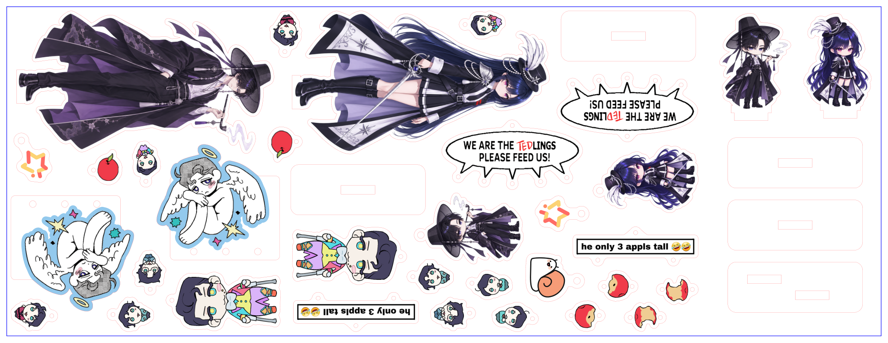

> **2026-11-20 칼선 곡선화 수정본입니다. 기존 다운로드를 교체하세요.** [전수 검사·변경 내용](https://github.com/ark1st/dpbr_goods/tree/output_len/output/cut_quality)

# 엑스트라38조각 · 5T

[전체 안내](../README.md)

이 폴더는 캐릭터와 받침 모두5mm인 경우입니다. 슬롯20.2×5.2mm, 돌기4.6mm.
인쇄·백색·재단 모두 이 폴더의 같은 버전을 사용합니다.
