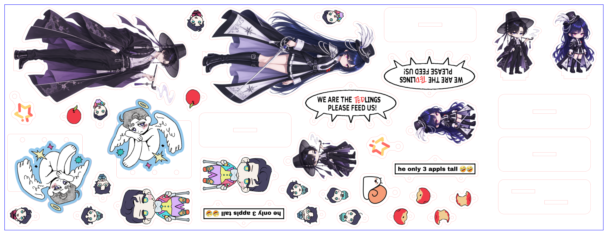

> **A3 전환으로 구버전 제작 대지는 퇴역했습니다. 현재 출력은 [A3 최종본](../a3_release/02_extra_sheet)을 사용하세요.** 원본과 조립 참고용으로 보관합니다.

> **2026-11-20 칼선 곡선화 수정본입니다. 기존 다운로드를 교체하세요.** [전수 검사·변경 내용](https://github.com/ark1st/dpbr_goods/tree/output_len/output/cut_quality)

# 엑스트라 시트 (김윤양지수) - yun 스탠드 추가38조각

**기존33조각 + 새yun 캐릭터2·받침3 = 총38조각. 527×204mm.**

| 판 두께 | 제작 파일 | 받침 홈 | 돌기 깊이 |
|---|---|---|---|
| 3T | [3T 폴더](3T) | 20.2×3.2mm | 2.6mm |
| 5T | [5T 폴더](5T) | 20.2×5.2mm | 4.6mm |

캐릭터와 받침이 같은 두께인 경우입니다. 실제 판에 맞는 한 폴더를 선택하세요.
최상단 파일은3T 파일의 사본입니다.5T는 반드시5T 폴더를 사용합니다.
**인쇄·백색·재단을 서로 다른 두께 폴더에서 섞어 사용하지 마세요.**

- 01_COMBINED_SHEET.pdf: 그림·파란 기준선이 기본으로 표시되는 합본.
- 02_PRINT_300ppi.png: UV 인쇄용 투명300ppi PNG.
- 03_CUT_ONLY.pdf: 빨강 #FF0000 /0.001mm 재단 전용.
- 04_WHITE_INK_MASK_300ppi.png 또는 PDF: 검정 영역을 백색 잉크로 지정하는 분판.
- 05_MASTER.ai / vectorcraft: 색상·기준선·칼선·백색 레이어를 분리한 편집 원본.

새yun 그림은 크기를 바꾸지 않고 오른쪽에 배치했습니다. 받침은각80×30mm.
받침3개는1인용2개와2인용1개로, 원본에 있는 선택용 받침을 모두 넣었습니다.
원본의 약8mm 긴 돌기는 판 아래로 돌출될 수 있어 **투명 수평 어깨와20mm 돌기**로 정리했습니다.
3T/5T용 돌기 깊이는각2.6/4.6mm, 홈은각3.2/5.2mm입니다. 그림·백색 크기는 바꾸지 않았습니다.
수정하지 않은 원본AI는main의assets/external에 보관합니다.

기존30개 외부 도안은 저장소에 새로 올라온각3T/5T 버전을 그대로 보존했습니다.
외부 캐릭터의 일반 외곽 여백은 변경하지 않았습니다.
단풍바람3개(단팽이1·미니 로고2)만 그림-칼선과 구멍-외곽을2.5mm로 줄였습니다.
기존33개 인쇄 그림은각두께 원본과 픽셀 비교로 보존을 확인했습니다.

폐곡선95개 = 외곽38개 +구멍·홈57개. PDF에서는49개 복합/단일 경로 객체입니다.
장비에서 내부 경로 우선 가공을 지정합니다.
최소 조각 간격6mm 이상, 실제 크기100%, 같은 원점, 자동 맞춤 해제.
파란 위치 사각형은 재단 대상이 아닙니다.
백색은 원본에서 제공된 부분만 보존했으며 나머지 그림은 기존처럼RIP에서 설정을 확인합니다.
홈과 돌기는 커프 보정 전 치수입니다. 같은 재료·장비로 끼움 시험 후 본 제작을 진행합니다.
실물 인쇄 정합·끼움 시험을 마쳤다는 의미가 아닙니다.
