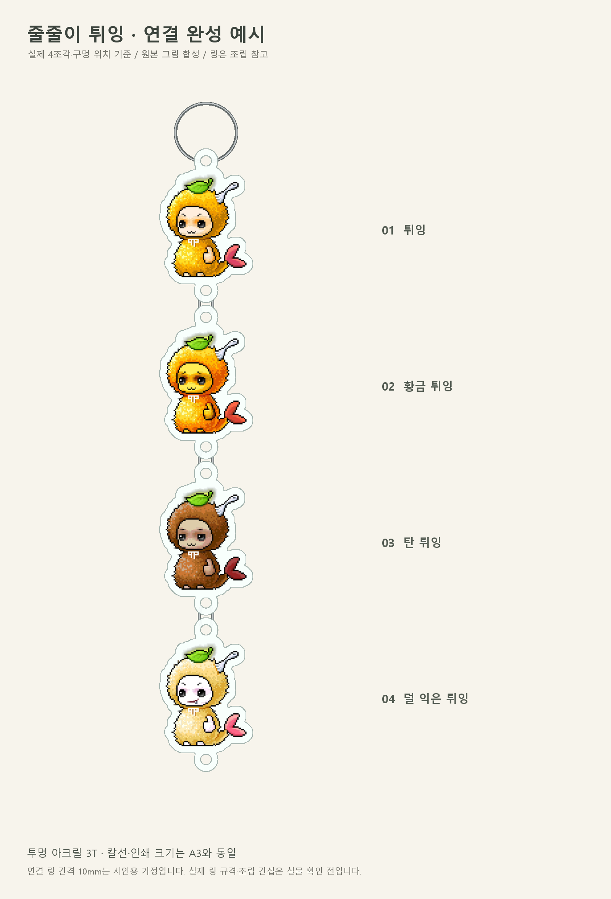
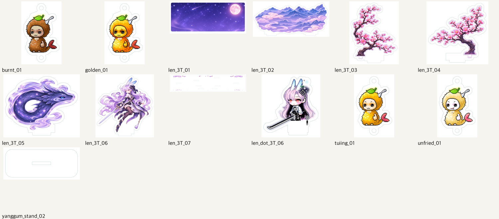
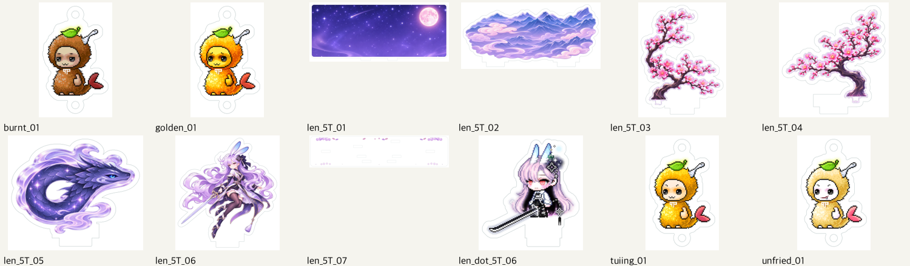
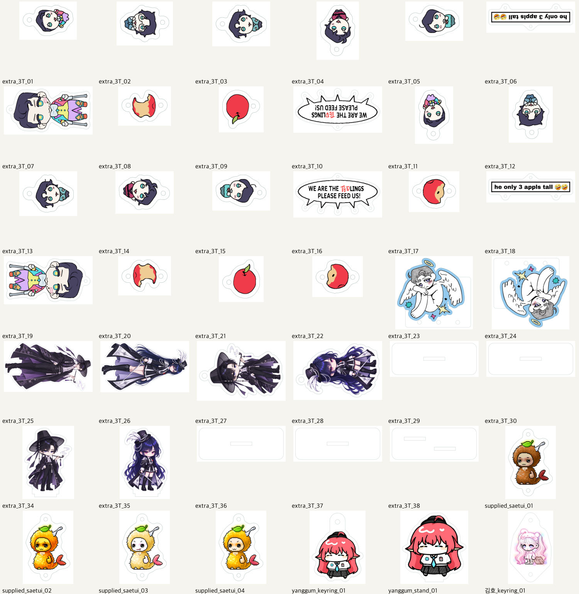
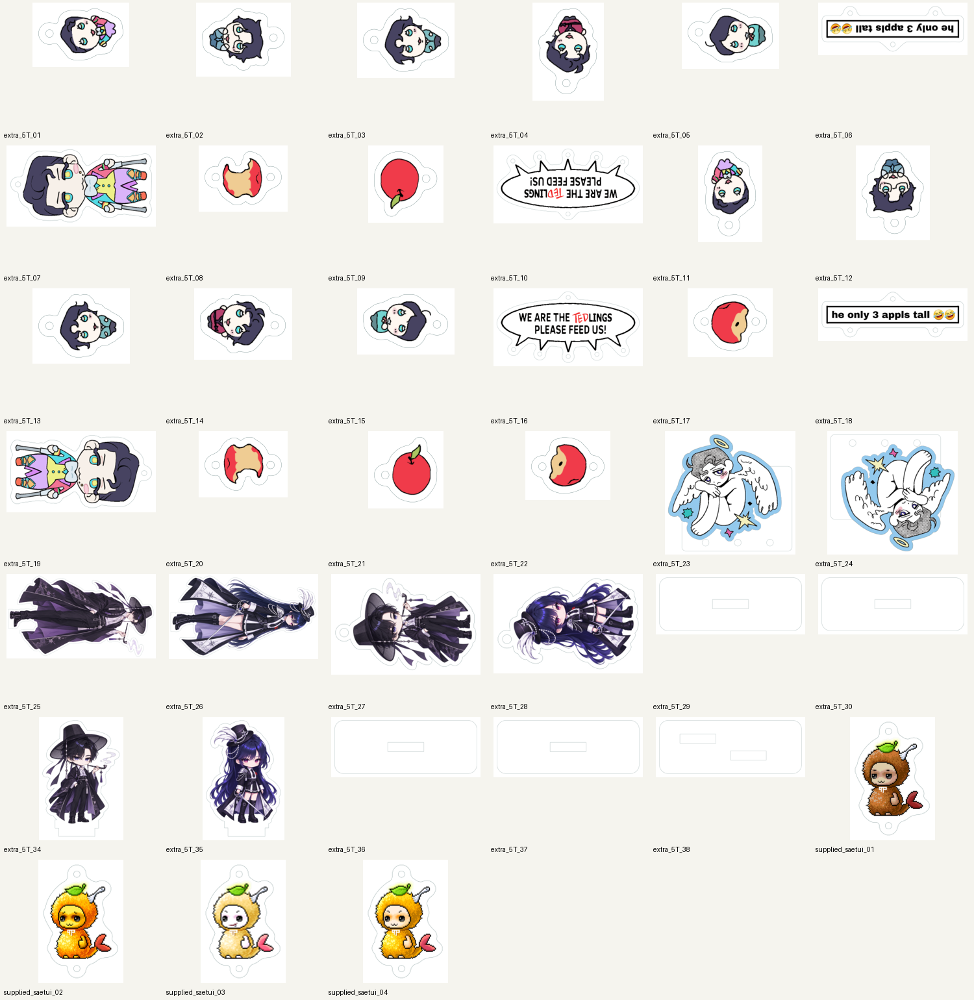
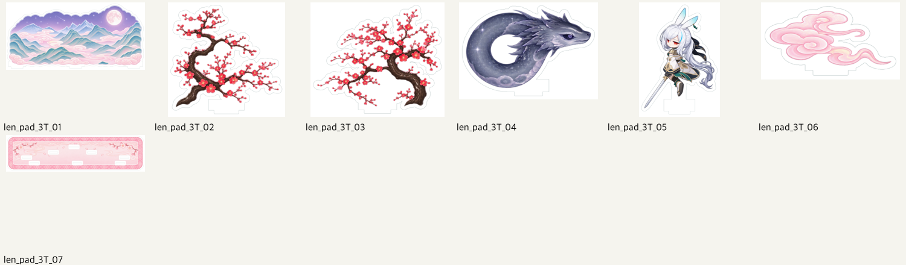
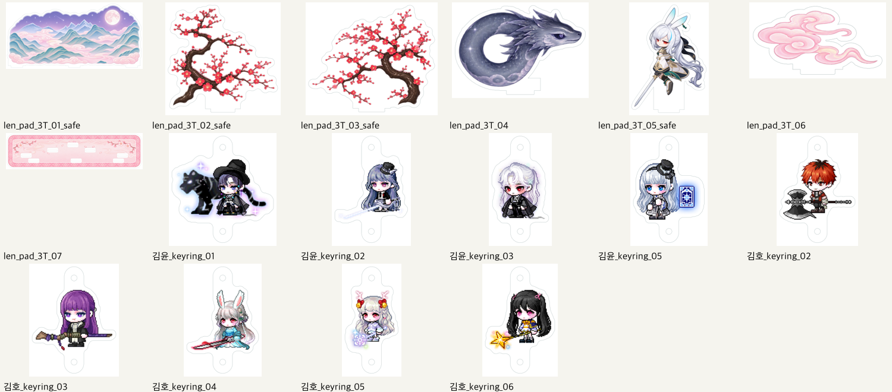
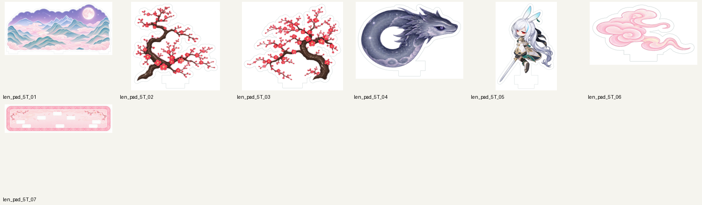

# 개별 에셋 · 실물 크기

A3는 출력용 배치이며, 아래 파일은 원본 방향의 독립 에셋입니다. 각 조각의 그림·백색·벡터 칼선을 따로 편집할 수 있습니다. 외부30개 도안은 원본의 회전 상태도 유지합니다. 받침도 별도 조각입니다. 3T가 현재 선택이고 5T는 대안입니다.

[출력용 A3](../a3_release) · [Len PAD 단독 원본·중복 출력 금지](../a3_release/06_len_pad) · [양검 단독 원본·중복 출력 금지](../a3_release/09_yanggum) · [단풍바람 원본 소스](../../assets)

링은 참고용 합성이고 아크릴 제작 파일에 포함하지 않습니다. 실물 조립 미검증.

## 05_len/3T

| 에셋 | 외곽 크기 mm |
|---|---|
| [burnt_01](burnt_01) | 35.013 × 57.361 |
| [golden_01](golden_01) | 35.013 × 57.361 |
| [len_3T_01](len_3T_01) | 255.945 × 105.300 |
| [len_3T_02](len_3T_02) | 133.527 × 59.512 |
| [len_3T_03](len_3T_03) | 61.467 × 79.543 |
| [len_3T_04](len_3T_04) | 65.921 × 67.546 |
| [len_3T_05](len_3T_05) | 70.699 × 57.543 |
| [len_3T_06](len_3T_06) | 77.153 × 83.540 |
| [len_3T_07](len_3T_07) | 275.000 × 60.000 |
| [len_dot_3T_06](len_dot_3T_06) | 52.606 × 56.626 |
| [tuiing_01](tuiing_01) | 35.013 × 57.361 |
| [unfried_01](unfried_01) | 35.013 × 57.361 |
| [yanggum_stand_02](yanggum_stand_02) | 72.000 × 28.000 |

## 05_len/5T

| 에셋 | 외곽 크기 mm |
|---|---|
| [burnt_01](burnt_01) | 35.013 × 57.361 |
| [golden_01](golden_01) | 35.013 × 57.361 |
| [len_5T_01](len_5T_01) | 255.945 × 107.300 |
| [len_5T_02](len_5T_02) | 133.527 × 61.512 |
| [len_5T_03](len_5T_03) | 61.467 × 81.543 |
| [len_5T_04](len_5T_04) | 65.921 × 69.546 |
| [len_5T_05](len_5T_05) | 70.699 × 59.543 |
| [len_5T_06](len_5T_06) | 77.153 × 85.540 |
| [len_5T_07](len_5T_07) | 275.000 × 60.000 |
| [len_dot_5T_06](len_dot_5T_06) | 52.606 × 58.626 |
| [tuiing_01](tuiing_01) | 35.013 × 57.361 |
| [unfried_01](unfried_01) | 35.013 × 57.361 |

## 02_extra_sheet/3T

| 에셋 | 외곽 크기 mm |
|---|---|
| [extra_3T_01](extra_3T_01) | 27.491 × 16.801 |
| [extra_3T_02](extra_3T_02) | 26.768 × 20.062 |
| [extra_3T_03](extra_3T_03) | 27.701 × 20.483 |
| [extra_3T_04](extra_3T_04) | 19.116 × 27.794 |
| [extra_3T_05](extra_3T_05) | 27.582 × 17.433 |
| [extra_3T_06](extra_3T_06) | 74.486 × 23.430 |
| [extra_3T_07](extra_3T_07) | 67.918 × 35.010 |
| [extra_3T_08](extra_3T_08) | 24.978 × 17.381 |
| [extra_3T_09](extra_3T_09) | 20.430 × 21.102 |
| [extra_3T_10](extra_3T_10) | 83.603 × 41.566 |
| [extra_3T_11](extra_3T_11) | 16.801 × 27.491 |
| [extra_3T_12](extra_3T_12) | 20.062 × 26.768 |
| [extra_3T_13](extra_3T_13) | 27.701 × 20.483 |
| [extra_3T_14](extra_3T_14) | 27.794 × 19.116 |
| [extra_3T_15](extra_3T_15) | 27.582 × 17.433 |
| [extra_3T_16](extra_3T_16) | 83.603 × 41.566 |
| [extra_3T_17](extra_3T_17) | 23.728 × 18.383 |
| [extra_3T_18](extra_3T_18) | 74.486 × 23.430 |
| [extra_3T_19](extra_3T_19) | 67.918 × 35.010 |
| [extra_3T_20](extra_3T_20) | 24.978 × 17.381 |
| [extra_3T_21](extra_3T_21) | 20.430 × 21.102 |
| [extra_3T_22](extra_3T_22) | 23.728 × 18.383 |
| [extra_3T_23](extra_3T_23) | 72.999 × 68.771 |
| [extra_3T_24](extra_3T_24) | 72.999 × 68.771 |
| [extra_3T_25](extra_3T_25) | 150.704 × 84.881 |
| [extra_3T_26](extra_3T_26) | 150.831 × 85.210 |
| [extra_3T_27](extra_3T_27) | 64.880 × 42.418 |
| [extra_3T_28](extra_3T_28) | 62.417 × 40.170 |
| [extra_3T_29](extra_3T_29) | 80.000 × 30.000 |
| [extra_3T_30](extra_3T_30) | 80.000 × 30.000 |
| [extra_3T_34](extra_3T_34) | 42.417 × 61.823 |
| [extra_3T_35](extra_3T_35) | 40.172 × 60.391 |
| [extra_3T_36](extra_3T_36) | 80.000 × 30.000 |
| [extra_3T_37](extra_3T_37) | 80.000 × 30.000 |
| [extra_3T_38](extra_3T_38) | 80.000 × 30.000 |
| [supplied_saetui_01](supplied_saetui_01) | 28.669 × 43.379 |
| [supplied_saetui_02](supplied_saetui_02) | 28.669 × 43.379 |
| [supplied_saetui_03](supplied_saetui_03) | 28.669 × 43.379 |
| [supplied_saetui_04](supplied_saetui_04) | 28.669 × 43.379 |
| [yanggum_keyring_01](yanggum_keyring_01) | 43.131 × 57.960 |
| [yanggum_stand_01](yanggum_stand_01) | 62.199 × 67.531 |
| [김호_keyring_01](김호_keyring_01) | 42.749 × 71.700 |

## 02_extra_sheet/5T

| 에셋 | 외곽 크기 mm |
|---|---|
| [extra_5T_01](extra_5T_01) | 27.491 × 16.801 |
| [extra_5T_02](extra_5T_02) | 26.768 × 20.062 |
| [extra_5T_03](extra_5T_03) | 27.701 × 20.483 |
| [extra_5T_04](extra_5T_04) | 19.116 × 27.794 |
| [extra_5T_05](extra_5T_05) | 27.582 × 17.433 |
| [extra_5T_06](extra_5T_06) | 74.486 × 23.430 |
| [extra_5T_07](extra_5T_07) | 67.918 × 35.010 |
| [extra_5T_08](extra_5T_08) | 24.978 × 17.381 |
| [extra_5T_09](extra_5T_09) | 20.430 × 21.102 |
| [extra_5T_10](extra_5T_10) | 83.603 × 41.566 |
| [extra_5T_11](extra_5T_11) | 16.801 × 27.491 |
| [extra_5T_12](extra_5T_12) | 20.062 × 26.768 |
| [extra_5T_13](extra_5T_13) | 27.701 × 20.483 |
| [extra_5T_14](extra_5T_14) | 27.794 × 19.116 |
| [extra_5T_15](extra_5T_15) | 27.582 × 17.433 |
| [extra_5T_16](extra_5T_16) | 83.603 × 41.566 |
| [extra_5T_17](extra_5T_17) | 23.728 × 18.383 |
| [extra_5T_18](extra_5T_18) | 74.486 × 23.430 |
| [extra_5T_19](extra_5T_19) | 67.918 × 35.010 |
| [extra_5T_20](extra_5T_20) | 24.978 × 17.381 |
| [extra_5T_21](extra_5T_21) | 20.430 × 21.102 |
| [extra_5T_22](extra_5T_22) | 23.728 × 18.383 |
| [extra_5T_23](extra_5T_23) | 72.999 × 68.771 |
| [extra_5T_24](extra_5T_24) | 72.999 × 68.771 |
| [extra_5T_25](extra_5T_25) | 152.704 × 84.881 |
| [extra_5T_26](extra_5T_26) | 152.831 × 85.210 |
| [extra_5T_27](extra_5T_27) | 64.880 × 42.418 |
| [extra_5T_28](extra_5T_28) | 62.417 × 40.170 |
| [extra_5T_29](extra_5T_29) | 80.000 × 30.000 |
| [extra_5T_30](extra_5T_30) | 80.000 × 30.000 |
| [extra_5T_34](extra_5T_34) | 42.417 × 63.823 |
| [extra_5T_35](extra_5T_35) | 40.171 × 62.391 |
| [extra_5T_36](extra_5T_36) | 80.000 × 30.000 |
| [extra_5T_37](extra_5T_37) | 80.000 × 30.000 |
| [extra_5T_38](extra_5T_38) | 80.000 × 30.000 |
| [supplied_saetui_01](supplied_saetui_01) | 28.669 × 43.379 |
| [supplied_saetui_02](supplied_saetui_02) | 28.669 × 43.379 |
| [supplied_saetui_03](supplied_saetui_03) | 28.669 × 43.379 |
| [supplied_saetui_04](supplied_saetui_04) | 28.669 × 43.379 |

## 06_len_pad/3T

| 에셋 | 외곽 크기 mm |
|---|---|
| [len_pad_3T_01](len_pad_3T_01) | 205.300 × 97.472 |
| [len_pad_3T_02](len_pad_3T_02) | 81.103 × 79.478 |
| [len_pad_3T_03](len_pad_3T_03) | 86.555 × 73.503 |
| [len_pad_3T_04](len_pad_3T_04) | 84.112 × 57.436 |
| [len_pad_3T_05](len_pad_3T_05) | 63.403 × 91.547 |
| [len_pad_3T_06](len_pad_3T_06) | 66.867 × 35.505 |
| [len_pad_3T_07](len_pad_3T_07) | 280.000 × 71.224 |

## 19_personal_fill/3T

| 에셋 | 외곽 크기 mm |
|---|---|
| [len_pad_3T_01_safe](len_pad_3T_01_safe) | 205.304 × 97.471 |
| [len_pad_3T_02_safe](len_pad_3T_02_safe) | 81.103 × 79.484 |
| [len_pad_3T_03_safe](len_pad_3T_03_safe) | 86.556 × 73.503 |
| [len_pad_3T_04](len_pad_3T_04) | 84.112 × 57.436 |
| [len_pad_3T_05_safe](len_pad_3T_05_safe) | 63.403 × 91.547 |
| [len_pad_3T_06](len_pad_3T_06) | 66.867 × 35.505 |
| [len_pad_3T_07](len_pad_3T_07) | 280.000 × 71.224 |
| [김윤_keyring_01](김윤_keyring_01) | 67.542 × 71.000 |
| [김윤_keyring_02](김윤_keyring_02) | 48.561 × 71.001 |
| [김윤_keyring_03](김윤_keyring_03) | 37.797 × 71.000 |
| [김윤_keyring_05](김윤_keyring_05) | 47.034 × 71.000 |
| [김호_keyring_02](김호_keyring_02) | 50.176 × 71.000 |
| [김호_keyring_03](김호_keyring_03) | 55.865 × 71.000 |
| [김호_keyring_04](김호_keyring_04) | 47.563 × 71.000 |
| [김호_keyring_05](김호_keyring_05) | 35.169 × 70.999 |
| [김호_keyring_06](김호_keyring_06) | 46.360 × 70.999 |

## 06_len_pad/5T

| 에셋 | 외곽 크기 mm |
|---|---|
| [len_pad_5T_01](len_pad_5T_01) | 205.300 × 99.472 |
| [len_pad_5T_02](len_pad_5T_02) | 81.103 × 81.478 |
| [len_pad_5T_03](len_pad_5T_03) | 86.555 × 75.503 |
| [len_pad_5T_04](len_pad_5T_04) | 84.112 × 59.436 |
| [len_pad_5T_05](len_pad_5T_05) | 63.403 × 93.547 |
| [len_pad_5T_06](len_pad_5T_06) | 66.867 × 37.505 |
| [len_pad_5T_07](len_pad_5T_07) | 280.000 × 71.224 |

## 09_yanggum/3T

| 에셋 | 외곽 크기 mm |
|---|---|
| [yanggum_keyring_01](yanggum_keyring_01) | 43.131 × 57.960 |
| [yanggum_stand_01](yanggum_stand_01) | 62.199 × 67.531 |
| [yanggum_stand_02](yanggum_stand_02) | 72.000 × 28.000 |

## 11_ascent_remaining/3T

| 에셋 | 외곽 크기 mm |
|---|---|
| [강민_stand_01](강민_stand_01) | 94.903 × 67.515 |
| [강민_stand_02](강민_stand_02) | 72.000 × 28.000 |
| [강윤진_stand_01](강윤진_stand_01) | 102.766 × 67.534 |
| [강윤진_stand_02](강윤진_stand_02) | 72.000 × 28.000 |
| [김윤_keyring_04](김윤_keyring_04) | 30.933 × 70.999 |
| [배승민_keyring_01](배승민_keyring_01) | 38.066 × 71.000 |
| [배승민_keyring_02](배승민_keyring_02) | 36.186 × 71.000 |
| [배승민_keyring_03](배승민_keyring_03) | 33.390 × 71.000 |
| [이상준_stand_01](이상준_stand_01) | 60.515 × 67.517 |
| [이상준_stand_02](이상준_stand_02) | 72.000 × 28.000 |
| [정지영_stand_01](정지영_stand_01) | 63.316 × 67.515 |
| [정지영_stand_02](정지영_stand_02) | 72.000 × 28.000 |

