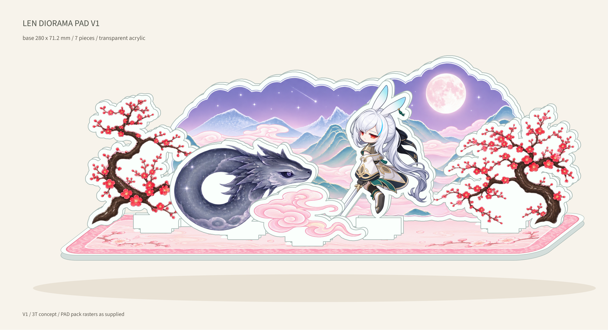

# 렌 아크릴 슬롯 디오라마 PAD V1 · 매화와 은빛 용, 구름 위의 달빛 무대



**본품 1세트 = 받침대 1 + 파츠 6, 총 7조각.**
3T와 5T는 같은 세트의 두께별 대안이며, 각 폴더는 1세트 분량입니다.

받침대 **280 × 71.2 mm** (인쇄 아트 275 × 66.2 mm + 사방 2.5 mm 투명 테두리), 완성 높이 3T 약 95.5 mm · 5T 약 97.5 mm, 깊이 71.2 mm.
시안 규격(약 W150)에서는 여섯 실루엣 파츠가 서로를 가리므로, 무대를 **W280 · D71.2**로 키워 네 깊이 행에 나누어 세웁니다(행 사이 웹 3T 8 mm / 5T 6 mm).
레이어 순서(뒤→앞): **① 별밤·산맥 배경(200×90 mm) → ② 매화 좌·우 → ③ 은빛 용 + 캐릭터 → ④ 분홍 구름(맨 앞).**
깊이 행(앞→뒤): 구름 23 → 용·캐릭터 34 → 매화 45 → 배경 56 mm. 홈은 모두 8개입니다.
용(x=95)·캐릭터(x=173)는 같은 행에서 6.4 mm 간격으로 서 있고, 앞 판이 뒷 판의 달·별을 가리지 않습니다(배경 상단 30% 밴드 가림 17%).

**그림 6종과 베이스 아트는 assets/len_pad 원본 PNG를 다시 그리지 않고 그대로 사용했습니다.**
각 그림을 300ppi 인쇄 해상도로만 변환(랜초스)해 인쇄 레이어에 넣었습니다. 03_장식파츠에 뭉쳐 있던 매화 좌·우·용·구름은 알파 섬 단위로 분리해 각각 한 판으로 만들었습니다.
캐릭터는 어두운 오라 배경까지 원본 그대로이며 컷선이 그 실루엣을 따라갑니다.
베이스는 시안에 그려진 슬롯 자리 5개(실측 약 32.5×4.1 / 23.9×4.1 mm로 18 mm 탭과 맞지 않는 예시)를 인접 무늬 이식으로 봉합하고, 실제 홈 8개 위치에만 잉크를 비운 뒤 인쇄합니다(변경 내역: `assets/len_pad/prepared/provenance.json`).

일반 외곽 여백 2.5 mm, 레이저 선 빨강 0.001 mm, 홈 모서리반경 0.35 mm, 돌기끝 사선 0.40 mm.
배경은 돌기 3개, 매화·용·캐릭터·구름은 돌기 1개. 돌기 폭은 공통 18 mm로 서로 교체할 수 있습니다.

## 먼저 시험 조각

기본 홈 너비 3.00/5.00 mm는 **절단 경로의 시작값**입니다. 실물 끼움은 아직 시험하지 않았습니다.
같은 판·같은 설정으로 `04_FIT_TEST`를 잘라 맞는 홈을 고른 뒤 본품을 자르세요.
기본 시험 범위: 3T 2.60-3.40 mm / 5T 4.60-5.40 mm, 0.10 mm 간격.

- 홈의 짧은 너비: **서 있는 파츠 판**의 두께와 시험 결과에 따라 결정.
- 돌기 길이: **받침대**의 실측 두께에서 0.40 mm 뺀 값. 기본 3T 2.60 mm / 5T 4.60 mm.
- 돌기와 홈 주변은 인쇄하지 않습니다. 보호필름 제거 후 손으로 시험합니다.

## 파일

- `00_ASSEMBLY_GUIDE.pdf`: 조립·치수·시험 순서와 A4 실측 확인자.
- 두께별 폴더 `01_PRINT_300ppi.png`(+PDF): 파란 기준선을 포함한 투명 PNG, 300ppi.
- `02_MASTER.ai` / `.vectorcraft` / `.svg`: 그림, 기준선, 재단선의 3개 레이어. 그림은 래스터 임베드.
- `03_CUT_ONLY.svg`(+PDF): 빨강 0.001 mm 폐곡선 15개(홈 8+외곽 7), 홈을 먼저 자릅니다.
- `04_FIT_TEST_*`: 9개 홈 시험판과 18 mm 돌기 시험키.
- `06_BASE_ONLY.svg` / `06_PIECES_ONLY.svg`: 판 두께를 서로 다르게 쓸 때 분리된 편집 도안.
- `parameters.json`, `validation_report.json`: 적용 치수 및 파일검사 결과.

**ZIP에는 인쇄·재단에 바로 쓰는 파일만 넣었습니다**: 인쇄 PNG, 마스터 AI, 재단 파일, 시험편, `06_BASE_ONLY`, 미리보기 PNG.
편집 원본(`.vectorcraft`·`02_MASTER.svg`·`01_PRINT.pdf`·`06_PIECES_ONLY.svg`)은 용량 때문에 이 저장소 폴더에만 들어 있습니다.
빌더를 다시 실행하면 언제든 재생성됩니다.

본품 작업영역 320×370 mm. 3T/5T의 인쇄·재단 좌표는 같습니다.
파란 사각형(4,4), 312×366 mm은 위치기준이며 자르지 않습니다. 실제 크기 100%로 출력합니다.

## 치수 조정

저장소 루트에서:

```powershell
python scripts/prepare_len_pad_base.py
python scripts/build_len_diorama_pad.py
# 시험에서 고른 절단경로 홈 너비가 2.80 mm인 경우(예시일 뿐 권장값 아님)
python scripts/build_len_diorama_pad.py --part-thickness 3 --base-thickness 3 --slot-width 2.80 --name calibrated_3T
# 파츠 3T + 받침대 5T: 두 재료를 따로 커팅
python scripts/build_len_diorama_pad.py --part-thickness 3 --base-thickness 5 --slot-width 2.80 --name mixed_3T_5T
```

`--part-thickness`와 `--base-thickness`에는 실측 소수값도 넣을 수 있습니다.
그림 높이·베이스 치수·홈 위치·돌기 폭은 `configs/len_diorama_pad.json`에서 관리합니다.
에셋 교체는 `assets/len_pad`의 같은 이름 PNG를 바꾸고(베이스는 전처리 스크립트도 다시) 빌더를 다시 실행하면 됩니다.

## 원본 해상도 안내

베이스 원본은 275 mm 폭 기준 약 192 ppi, 배경 약 203 ppi, 장식 파츠 155-250 ppi, 캐릭터는 300 ppi 이상입니다.
300 ppi 출력 파일은 이 원본을 랜초스로 리샘플한 값이며, 원본에 없는 디테일을 더하지 않습니다.

## 가공 참고

아래는 커프와 시험 가공 원칙의 근거입니다. 해당 업체의 장비수치를 우리 장비 값으로 대입하지 않았습니다.

- [Ponoko - Interlocking 3D laser cut designs](https://help.ponoko.com/en/articles/4527166-interlocking-3d-laser-cut-designs)
- [Ponoko - How much material does the laser burn away?](https://help.ponoko.com/en/articles/4442594-how-much-material-does-the-laser-burn-away)

캐릭터·용·배경 일러스트의 저작권은 원저자와 제작자에게 있습니다. 제작 파일을 재배포하지 마세요.
