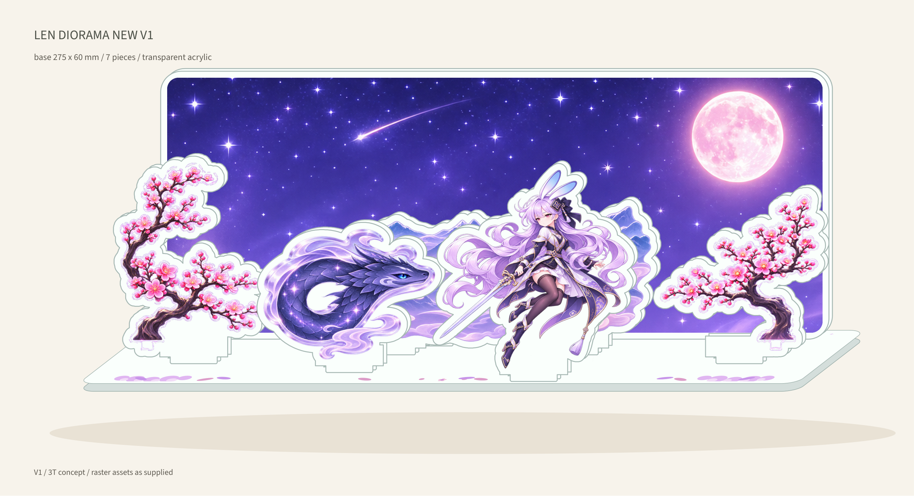

# 렌 아크릴 슬롯 디오라마 NEW V1 · 달빛과 매화, 그리고 뱀의 수호



**본품 1세트 = 받침대 1 + 파츠 6, 총 7조각.**
3T와 5T는 같은 세트의 두께별 대안이며, 각 폴더는 1세트 분량입니다.

받침대 **275×60mm**, 완성 높이 3T 약 103mm · 5T 약 105mm, 완성 크기 약 W275×H103(3T)·H105(5T)×D60mm.
시안 규격(약 W150)에서 네 실루엣 파츠(매화좌·뱀·캐릭터·매화우)가 서로를 가리지 않도록 무대를 키워 W275·D60입니다(깊이 행 5개, 행 사이 웹 3T 7mm / 5T 5mm).
레이어 순서(뒤→앞): **① 별밤 배경판(251×98mm) → ② 산맥·구름 → ③ 매화 좌·우 → ④ 뱀 수호령 → ⑤ 캐릭터.**
깊이 행(앞→뒤): 캐릭터 10 → 뱀 20 → 매화 30 → 산맥 40 → 배경판 50mm. 홈은 모두 8개입니다.
네 파츠는 매화좌(x≈31) → 뱀(x≈100) → 캐릭터(x≈170) → 매화우(x≈240) 순으로 각자의 폭을 차지해, 앞 판이 뒷 판의 그림을 가리지 않습니다.

**그림 6종은 assets/len의 원본 PNG를 다시 그리지 않고 그대로 사용했습니다.**
각 그림을 300ppi 인쇄 해상도로만 변환(랜초스)해 인쇄 레이어에 넣었습니다. 별밤 배경판만 원본 상단 65% 띠를 사용합니다(달·유성 포함, 인쇄 배율 그대로). 별밤 판 모서리는 R8로 둥글게 깎아 재단하며 인쇄 그림도 같은 라운드로 끝납니다. 베이스 앞면의 구름·꽃 장식만
참고 A·B의 팔레트로 새로 벡터 디자인한 것입니다. 캐릭터는 폴더의 최신 `캐릭터.png`를 따랐습니다.

일반 외곽 여백2.5mm, 레이저 선 빨강0.001mm, 홈 모서리반경0.35mm, 돌기끝 사선0.40mm, 별밤 판 모서리 R8·받침대 R6 라운드.
배경판·산맥은 돌기 2개(±25/±35mm), 매화·뱀·캐릭터는 돌기 1개. 돌기 폭은 공통 18mm로 서로 교체할 수 있습니다.

## 먼저 시험 조각

기본 홈 너비3.00/5.00mm는 **절단 경로의 시작값**입니다. 실물 끼움은 아직 시험하지 않았습니다.
같은 판·같은 설정으로 `04_FIT_TEST`를 잘라 맞는 홈을 고른 뒤 본품을 자르세요.
기본 시험 범위: 3T 2.60-3.40mm / 5T 4.60-5.40mm, 0.10mm 간격.
번호는 왼쪽 위부터 가로 방향으로1-9입니다. 숫자 레이어는 커팅 대상이 아닙니다.

- 홈의 짧은 너비: **서 있는 파츠 판**의 두께와 시험 결과에 따라 결정.
- 돌기 길이: **받침대**의 실측 두께에서0.40mm 뺀 값. 기본3T 2.60mm /5T 4.60mm.
- 돌기와 홈 주변은 인쇄하지 않습니다. 보호필름 제거 후 손으로 시험합니다.
- 본품과 시험판은 별개입니다. 3T/5T 파일을 한꺼번에 출력하지 않습니다.

## 파일

- `00_ASSEMBLY_GUIDE.pdf`: 조립·치수·시험 순서와 A4 실측 확인자.
- 두께별 폴더 `01_PRINT_300ppi.png`(+PDF): 파란 기준선을 포함한 투명 PNG, 300ppi.
- `02_MASTER.ai` / `.vectorcraft` / `.svg`: 그림, 기준선, 재단선의3개 레이어. 그림은 래스터 임베드.
- `03_CUT_ONLY.svg`(+PDF): 빨강0.001mm 폐곡선15개(홈8+외곽7), 홈을 먼저 자릅니다.
- `04_FIT_TEST_*`: 9개 홈 시험판과18mm 돌기 시험키. 혼합두께이면 BASE/KEY 분리파일을 서로 다른 판에 출력.
- `06_BASE_ONLY.svg` / `06_PIECES_ONLY.svg`: 판 두께를 서로 다르게 쓸 때 분리된 편집 도안.
- `parameters.json`, `validation_report.json`: 적용 치수 및 파일검사 결과.

**ZIP에는 인쇄·재단에 바로 쓰는 파일만 넣었습니다**: 인쇄 PNG, 마스터 AI, 재단 파일, 시험편, `06_BASE_ONLY`, 미리보기 PNG.
편집 원본(`.vectorcraft`·`02_MASTER.svg`·`01_PRINT.pdf`·`06_PIECES_ONLY.svg`)은 용량 때문에 이 저장소 폴더에만 들어 있습니다.
빌더를 다시 실행하면 언제든 재생성됩니다.

본품 작업영역320×370mm. 3T/5T의 인쇄·재단 좌표는 같습니다.
파란 사각형(4,4),312×366mm은 위치기준이며 자르지 않습니다. 실제 크기100%로 출력합니다.
전면 정방향 인쇄가 기본입니다. 후면 인쇄라면 백색잉크와 반전 순서를 현장 방식에 맞춥니다.

## 치수 조정

저장소 루트에서:

```powershell
python scripts/build_len_diorama.py
# 시험에서 고른 절단경로 홈 너비가 2.80mm인 경우(예시일 뿐 권장값 아님)
python scripts/build_len_diorama.py --part-thickness 3 --base-thickness 3 --slot-width 2.80 --name calibrated_3T
# 파츠3T + 받침대5T: 두 재료를 따로 커팅
python scripts/build_len_diorama.py --part-thickness 3 --base-thickness 5 --slot-width 2.80 --name mixed_3T_5T
```

`--part-thickness`와`--base-thickness`에는 실측 소수값도 넣을 수 있습니다.
그림 높이·베이스 치수·홈 위치·돌기 폭은 `configs/len_diorama.json`에서 관리합니다.
에셋 교체는 `assets/len/01_…` 폴더의 같은 번호 PNG를 바꾸고 빌더를 다시 실행하면 됩니다.

## 가공 참고

아래는 커프와 시험 가공 원칙의 근거입니다. 해당 업체의 장비수치를 우리 장비 값으로 대입하지 않았습니다.

- [Ponoko - Interlocking 3D laser cut designs](https://help.ponoko.com/en/articles/4527166-interlocking-3d-laser-cut-designs)
- [Ponoko - How much material does the laser burn away?](https://help.ponoko.com/en/articles/4442594-how-much-material-does-the-laser-burn-away)

캐릭터·뱀·배경 일러스트의 저작권은 원저자와 제작자에게 있습니다. 제작 파일을 재배포하지 마세요.
