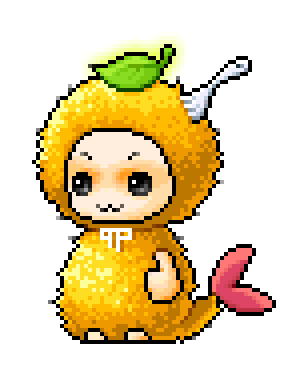
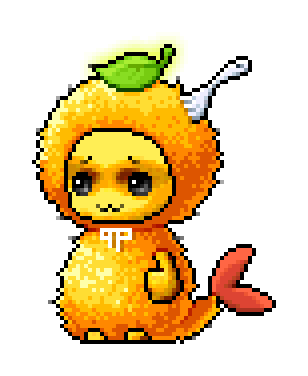
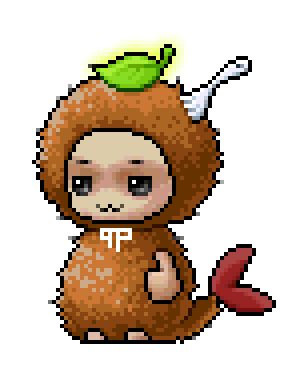
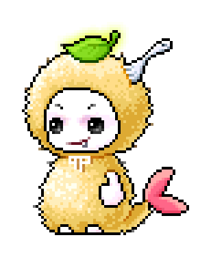

# 튀잉 연결형 키링 기획

문서의 3번 항목을 반영한 **다음 제작용 기획**입니다. 내일 출력하는 단바·엑스트라 합본에는 추가하지 않았습니다.

| 튀잉 기본 | 황올튀잉 | 탄튀잉 | 안튀잉 |
|---|---|---|---|
|  |  |  |  |

기본 구조: 위쪽 잠금고리 → 캐릭터 → 연결링 → 다음 캐릭터. 상하 구멍을 두어 순서와 수량을 바꾸는 방식입니다.
각 그림은 원본 비율을 유지하고 가로 약30mm, 고리 포함 높이 약40~60mm 범위에서 조정합니다.
구멍 지름4mm, 구멍-외곽2.5mm, 일반 투명 여백2.5mm를 시작값으로 제안합니다.
캐릭터 머리나 발을 관통하지 않도록 별도 투명 고리 부분을 만들고, 맨 아래 부품은 하단 구멍을 생략할 수 있습니다.

문서상 캐릭터 구성·연결 순서·실제 크기는 미확정입니다. 위 이미지는 문서에 담긴 참고 원본이며 최종 컷 파일이 아닙니다.
폭30mm만 맞추어 캐릭터들의 높이를 강제로 같게 만들지 않습니다.
한 줄에4개를 모두 달면 상당히 길어질 수 있어 기본2~3개+선택 교체를 제안합니다.
문서의 카라비너와 결합한다면 먼저 금속 게이트와 연결링이 여유 있게 움직이는지 실물 시험합니다.

[사용자가 반영을 요청한 제작 문서](https://docs.google.com/document/d/1zasgvxLgu7rkULyPR1h_cZRGx2P14C4--0cpYaosGhA)
