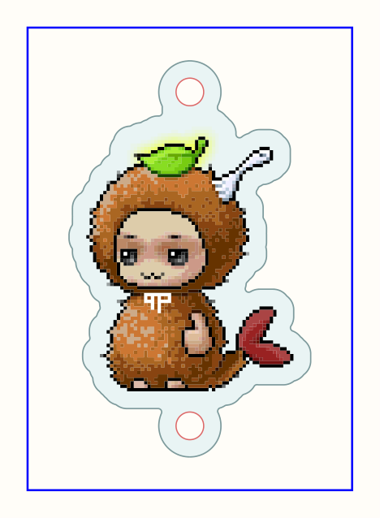
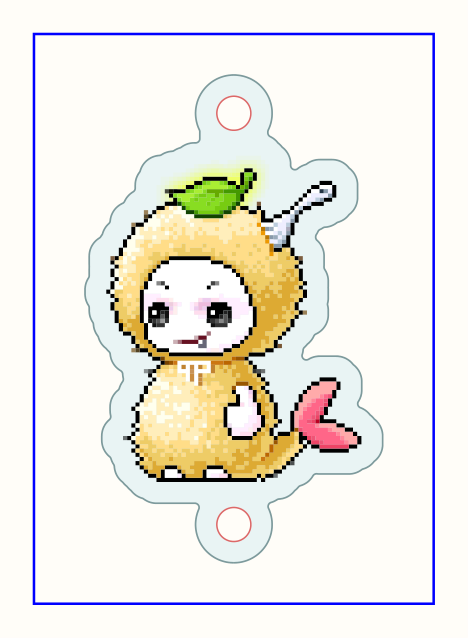
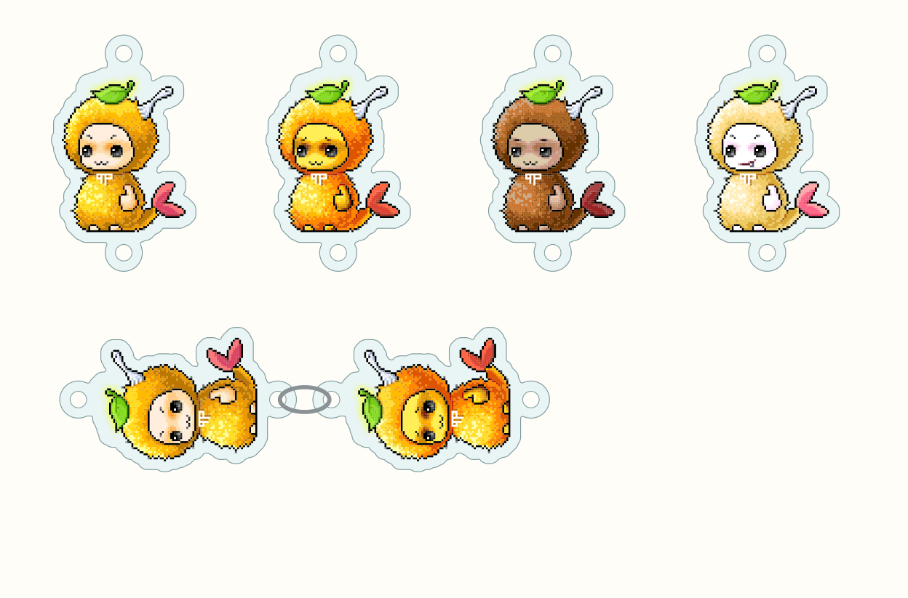

> **2026-11-20 칼선 곡선화 수정본입니다. 기존 다운로드를 교체하세요.** [전수 검사·변경 내용](https://github.com/ark1st/dpbr_goods/tree/output_len/output/cut_quality)

# 연결형 튀잉 4종 · 각각 별도 판

**기본·황올·탄·안튀잉을 각각 55×75mm 단독 판으로 만들었습니다. 각1개, 총4개입니다.**
단바·엑스트라 합본과 별개의 파일입니다.

| 도안·다운로드 | 시안 | 판 크기·수량 |
|---|---|---|
| [튀잉 기본](tuiing/README.md) |  | 55×75mm ·1개 |
| [황올튀잉](golden/README.md) |  | 55×75mm ·1개 |
| [탄튀잉](burnt/README.md) |  | 55×75mm ·1개 |
| [안튀잉](unfried/README.md) |  | 55×75mm ·1개 |

[4종 전체 ZIP](../Tuiing_Linked_4_Separate_Plates.zip)

위 줄은 기본·황올·탄·안튀잉 순서입니다. 아래는 기본과황올을 연결한 평면 설명도입니다.
금속 연결링은 조립 예시이며 인쇄·재단 파일에는 들어 있지 않습니다.

그림 폭30mm, 높이38.36mm. 고리 포함 아크릴은 약35×57.36mm입니다.
네 원본의 픽셀 배치·색·투명도를 그대로 벡터로 옮겼으며 새로 그리지 않았습니다.
각 부품 위아래에4mm 구멍을 두어 순서를 바꿔 연결할 수 있습니다.
투명 외곽2.5mm, 구멍-외곽2.5mm, 구멍-그림3mm 이상입니다.
최하단도 다른 위치로 바꿀 수 있도록 두 구멍을 모두 유지했습니다.

3T·5T 모두 같은 평면 칼선입니다. 연결링은 실제 판 두께에 맞춰 선택하며 실물 조립은 시험 전입니다.
네 개를 한 줄로 연결하면 길어지므로 먼저2개를 연결해 길이와 회전 여유를 확인하세요.
구멍을 먼저, 외곽을 나중에 절단합니다. 레이저 선은빨강0.001mm입니다.
파란 위치 기준선은 절단하지 않습니다. 인쇄·재단은 같은 원점에서100% 실제 크기입니다.

[참고 원본이 포함된 제작 문서](https://docs.google.com/document/d/1zasgvxLgu7rkULyPR1h_cZRGx2P14C4--0cpYaosGhA) · [원본·벡터 소스](https://github.com/ark1st/dpbr_goods/tree/main/assets/linked_tuiing)
