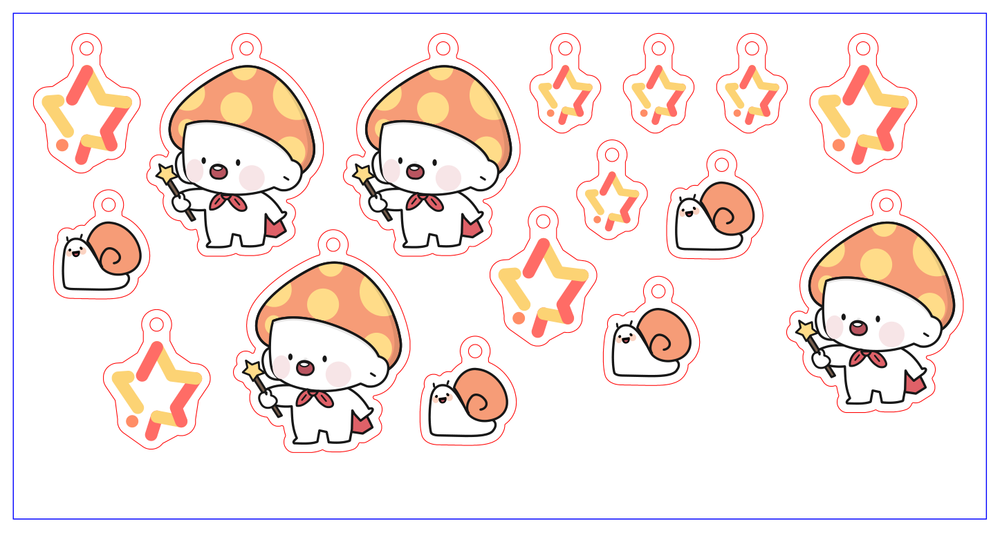

# 마스코트·로고 키링 V4 · 16조각

4세트 + 로고 단독 4개입니다. 한 세트는 가람·단팽이·미니 로고 각 1개입니다.
작업 영역 300×160mm, 가람 높이 55mm, 단팽이 높이 20.86mm로 원본 비율을 유지했습니다.
일반 투명 여백과 구멍-외곽 여유는 2.5mm입니다. 실제 레이저 선은 빨강 0.001mm입니다.

- [UV 인쇄 PNG](01_PRINT_300ppi.png): 투명 300ppi, 파란 위치 기준선 포함.
- [편집용 AI](02_MASTER.ai): 그림·위치 기준선·칼선 3개 레이어.
- [재단 전용 PDF](04_CUT_ONLY.pdf): 32개 폐곡선.
- [시안과 제작 안내 PDF](00_REVISION_GUIDE.pdf)
- [전체 ZIP](../Danpungbaram_V4_SMALL_BATCH_16pcs.zip)

인쇄·재단은 같은 원점과 실제 크기 100%로 진행합니다. 파란 기준선은 절단하지 않습니다.
optional_800x600은 같은 16조각을 큰 대지에 놓은 대안이므로 중복 출력하지 않습니다.
