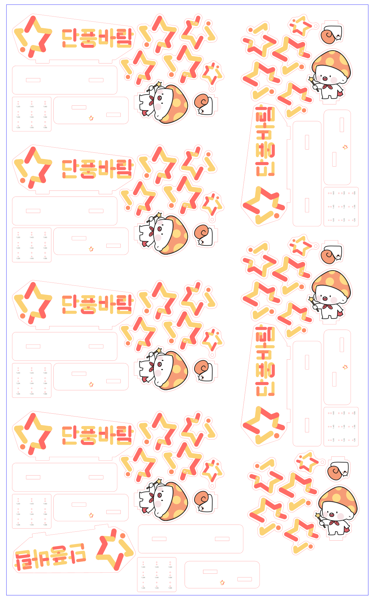
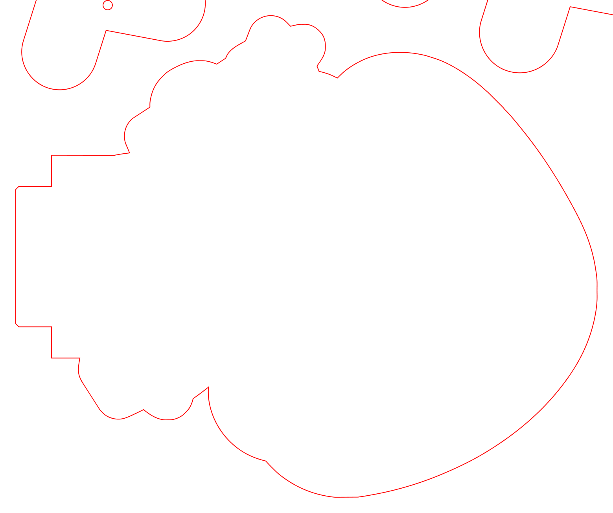

# 500×800mm 이미 인쇄된 판 · 재커팅 전용

**A3가 아닙니다. 새 인쇄 없이 기존 판을 다시 자르는 복구 파일입니다.**
원본 대지 499.998981×800.001212mm, 배율100%, 이동0, 회전0을 유지했습니다.

- `03_CUT_ONLY.ai` / PDF / SVG / VectorCraft: 같은 위치의 재단 전용 벡터. 빨강0.001mm.
- 원본77조각·294폐곡선을 모두 유지하고 내부 구멍을 먼저 배치했습니다.
- 이동 명령 309,920 → 4,392. 최대 원본 경로 차이 0.018576mm.
- 구멍 외곽 치수의 최대 차이 0.000194mm. 실제 커팅 속도·끼움은 실물 미검증입니다.

**장비에서도100%·같은 대지 원점으로 사용하세요. 자동 맞춤·개별 조각 재배치는 하지 않습니다.**
중지 전에 이미 잘린 구간은 파일만으로 알 수 없습니다. 작업자가 완료·분리된 조각을 확인해 재커팅 대상을 선택해야 합니다.
기존에 인쇄된 시험 디자인도 원본 그대로 복구하며 새 시험편·인쇄용 대지는 추가하지 않습니다.

[전체 검증 기록](validation.json) · [A3 출력 목록](../../a3_release)
