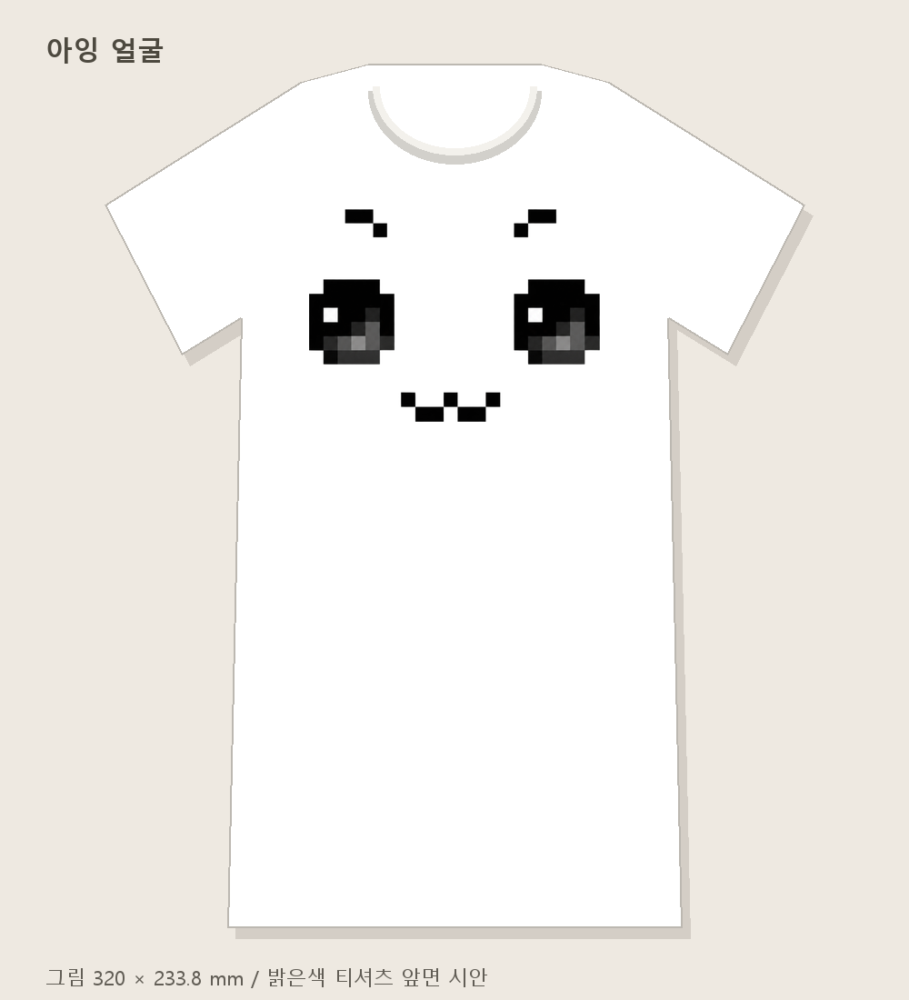

# 아잉 얼굴 티셔츠

**내일은 01_DTG_14x16in_300ppi.png를 가져가세요.**
흰색·밝은색 티셔츠 앞면에 크게 넣는 파일입니다. 시안의 티셔츠 크기는 예시이며 실제 옷에 맞춰 위치를 잡습니다.

| 파일 | 용도 |
|---|---|
| 01_DTG_14x16in_300ppi.png | 안내문 규격 그대로:355.6×406.4mm,4200×4800px,투명 PNG |
| 02_ARTWORK_300ppi.png | 여백 없는 그림 단독 파일 |
| 03_ACTUAL_SIZE.pdf | 배치·실제 크기 확인용 |
| 04_PLACEMENT.svg | PNG를 내장한 편집용 배치 |
| preview_tshirt.png | 옷에 올린 설명용 시안, 이 파일을 인쇄하지 않음 |

그림 크기 **320×233.8mm**.
원 안내문의 DTG 최대 출력355.6×406.4mm 이내입니다.
인쇄는100% 실제 크기, 정방향으로 합니다. DTG 직접 인쇄이므로 거울 반전하지 않습니다.
티셔츠 앞뒤·소매 전체를 감싸는 올오버 방식이 아니라 앞면의 넓은 인쇄 영역을 사용하는 파일입니다.
PNG는sRGB입니다. RIP에서 장비 프로파일과 밝은색 원단 설정을 적용합니다.

사용자가 확인한 아잉 시안으로 제작했습니다. 네모난 픽셀 모양과 투명 배경을 유지했습니다.
